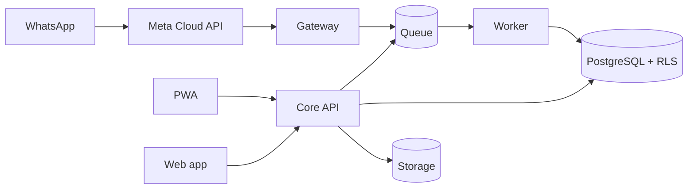

# Architecture summary

One-page view of Kritvo's design. Details: [HLD](HLD.md) (why and what) and [LLD](LLD.md) (how).

| Aspect | Decision | Reference |
| --- | --- | --- |
| Product | Multi-tenant SaaS for asset-based B2B service contractors; industry templates on one core | HLD 3, 6 |
| Field channel | WhatsApp Cloud API for the daily loop; PWA for offline and heavy tasks | HLD 7, ADR-0002 |
| Backend stack | Python 3.13, FastAPI, Pydantic v2, SQLAlchemy 2 async, Alembic, uv | ADR-0007 |
| Service shape | Modular monolith (FastAPI), separate gateway and worker processes | HLD 8 |
| Repositories | `kritvo-api` (backend, infra, docs, OpenAPI contract) and `kritvo-web` (UI) | LLD 1.1, ADR-0006 |
| Tenancy | Shared PostgreSQL schema with forced row-level security | LLD 2, ADR-0001 |
| Field data | Append-only events with client operation IDs; office edits use versions | LLD 7, ADR-0004 |
| Workflow | Versioned JSON workflows; guards and effects from a code registry | LLD 4 |
| Trust | Evidence risk score plus human review; customer OTP as strongest proof | HLD 10, LLD 8, ADR-0005 |
| Inventory | Double-entry stock ledger with part obligations | LLD 9 |
| Background work | Postgres-backed queue, single scheduler leader | LLD 10, ADR-0003 (open) |
| Hosting | AWS Mumbai; logs kept in India for 180 days | HLD 11–12 |
| Compliance | DPDP full obligations by 13 May 2027; GST invoicing rules | HLD 11 |

