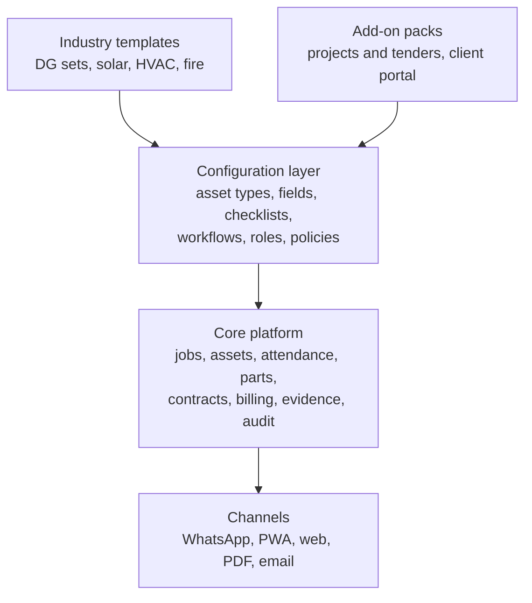
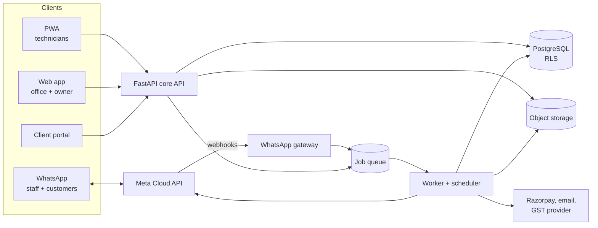
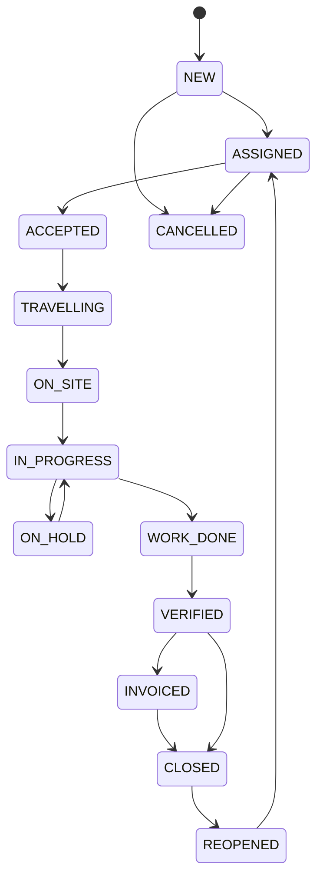
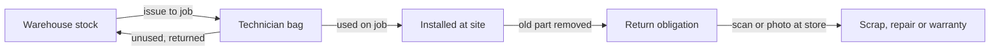

# Kritvo — High-Level Design (HLD)

| Field | Value |
| --- | --- |
| **Version** | 2.1 |
| **Status** | Draft for review |
| **Last updated** | 2026-09-22 |
| **Owner** | Project lead |
| **Companion** | [LLD](LLD.md) · [Architecture summary](ARCHITECTURE.md) · [ADRs](../adr/README.md) |
| **Supersedes** | [Opsly HLD v1.0](archive/HLD-v1.0-opsly.md) |

> Source of truth: this file on `main`. Change it only through a pull request that bumps **Version** and adds a row to the Revision history at the end.

## 1. Executive summary and product name

The product is renamed **Kritvo** and repositioned from one company's internal tool into a multi-tenant SaaS: a WhatsApp-first field operations platform for Indian service and maintenance contractors.

### 1.1 What changes from v1.0

| Area | v1.0 (Opsly) | v2.0 (Kritvo) |
| --- | --- | --- |
| Business model | Internal tool for Rahul Electricals | Subscription SaaS; Rahul Electricals is design partner and first reference customer |
| Customer | One DG-set contractor | Service contractors with 5 to 200 field staff, starting with power and electrical equipment |
| Domain model | DG sets, AMC and tenders hard-coded | Generic assets, job types, checklists and workflows per tenant, with industry templates |
| Field staff channel | PWA only | WhatsApp for the daily loop, PWA for heavy tasks, native Android wrapper later |
| Trust model | Claims GPS and selfie are proof | Evidence plus risk score plus human review, stated honestly |
| Architecture | Single-tenant FastAPI app with in-process scheduler | Multi-tenant modular monolith, PostgreSQL row-level security, separate worker |
| Money | Expense tracking only | Quotes, GST invoices, payment links, per-job profit |

### 1.2 Why the name Kritvo

- **Meaning:** from Sanskrit *kṛtvā*, "having done it". The product's core promise is proof that work was done.
- **Sound:** two syllables (KRIT-vo), easy to say in Hindi and English, and easy to type on a phone.
- **Distinct:** it is a coined word, which Indian trademark examiners treat as inherently distinctive, unlike descriptive words such as "FieldPro".
- **Clear search space:** web searches on 17 Sep 2026 found no company, app or product using it; only a personal Instagram handle and an Etsy username.
- **One caution:** it sits near the Slavic word *krivo* ("crooked"). This matters only if you enter Eastern European markets.

### 1.3 Names considered and rejected

| Name | Finding | Verdict |
| --- | --- | --- |
| Kritvo | No commercial use found | Recommended |
| Karvao | No software use, but it is a common Hindi verb and a viral meme phrase ("meri shaadi karvao"); weak trademark, jokey feel | Backup for a Hindi-market sub-brand only |
| Opsly | Temporary name; crowded "Ops-" prefix in DevOps tools | Rejected |
| Field-anything (Fieldkar, etc.) | Category is crowded: FieldEdge, Fieldwire, FieldPulse, FieldAware, Fieldpoint, Fieldster | Rejected, high confusion risk |
| OpSutra | Already used as an IIM Jammu competition name | Rejected |
| Sevaro | Funded US teleneurology company with that name | Rejected |
| KaamOS | Already used as a module name by Sassy (a work OS with attendance) and by Kaamos AI | Rejected, direct overlap |
| Proofloop | Used by several developer tools on GitHub and a SaaS waitlist tool | Rejected |

### 1.4 Availability: what is verified and what you must verify

Web search can show that nobody visibly uses a name. It cannot prove a domain or trademark is free. Do these checks before spending money on branding, in this order:

1. **Domains:** search `kritvo.com`, `kritvo.in` and `kritvo.app` at any registrar. Buy `.com` and `.in` the same day if free; it costs about the price of a lunch and blocks squatters.
2. **Trademark:** run a wordmark search on the IP India public search portal in Class 9 (software) and Class 42 (SaaS). Also check phonetic variants: Kritva, Critvo, Kritwo.
3. **File the trademark** in Classes 9 and 42, ideally through an agent. Startups and small enterprises pay a reduced government fee; confirm the current fee on the IP India site.
4. **Company name:** check and reserve through the MCA "Reserve Unique Name" service, for example *Kritvo Technologies Private Limited*.
5. **Handles:** `@kritvo` on Instagram is taken by an individual. Reserve `kritvohq` or `kritvo.app` across Instagram, LinkedIn, X and YouTube, and search the Play Store for clashes.
6. **WhatsApp display name:** Meta checks that the display name matches the business behind the number, so register the company or trade name before applying.

If any check fails, fall back to the next coined candidate rather than a descriptive name.

### 1.5 Decisions this document commits to

- Build one multi-tenant platform with industry templates, not a custom app per client.
- Start with power and electrical equipment service in Delhi NCR, then expand to HVAC, solar, fire safety, lifts and facility management.
- Make WhatsApp the default daily channel for field staff and end customers.
- Sell per active field user per month, with a free tier small enough to convert.
- Keep the stack from v1.0 (FastAPI, PostgreSQL, React PWA) and fix its multi-tenancy, scheduling and trust gaps.

## 2. Validation of the Opsly v1.0 HLD

The v1.0 document solves the right problems for one company, but it cannot become a product business as written: it is single-tenant, hard-codes the DG-set domain, and promises anti-fraud guarantees a browser app cannot deliver.

### 2.1 What holds and is carried forward

- The seven pain points are real and common to every Indian field-service SME, not only DG-set servicing.
- Server-side truth for timestamps and validation, RBAC enforced in the API, idempotent sync with client UUIDs, soft deletes, and an audit log.
- The stack: FastAPI, PostgreSQL, React PWA, object storage. It is proven, cheap to run, and hireable in India.
- Closed-loop parts control (part bound to a job, old part must come back) is the strongest differentiator in the v1 design.

### 2.2 What breaks

| # | v1 statement | Problem | v2 fix | Severity |
| --- | --- | --- | --- | --- |
| 1 | No tenant concept anywhere in the data model | A SaaS needs tenant isolation from day one; retrofitting it later means touching every table, query and test | `tenant_id` on every row plus PostgreSQL Row-Level Security | Critical |
| 2 | `dg_sets` table, AMC fields and tender module baked into core | Only fits DG-set contractors; an HVAC, solar or lift company cannot use it | Generic `assets` with tenant-defined asset types and custom fields; DG sets become a template | Critical |
| 3 | Fixed roles: Owner, Moderator, Staff | Every customer names and splits roles differently (branch manager, storekeeper, accountant) | Tenant-configurable roles built from a fixed permission catalogue | Major |
| 4 | Punch-in blocked when a technician has no ticket that day | Breaks office days, standby, training, travel and store duty | Attendance policies per tenant: office geofence, any assigned site, or free punch with flag | Major |
| 5 | Ticket cannot reach COMPLETED while a part is PENDING\_RETURN | Old parts often come back the next day; this delays client sign-off and billing | Job can complete; the parts obligation stays open with its own SLA and blocks CLOSED, not COMPLETED | Major |
| 6 | Barcode scan mandatory, manual entry never allowed; one table holds both serial number and quantity | Oil, coolant, filters and cable are bulk items; labels get damaged | Split serialised items from quantity-tracked stock; manual entry allowed only with photo and approver | Major |
| 7 | Offline sync uses last-write-wins on server timestamp, plus optimistic locking | Server time at sync is not action time, and the two rules contradict each other | Per-entity conflict policy: append-only events for field actions, version checks for office edits | Major |
| 8 | Background Sync API for the offline queue | Not supported in Safari or Firefox, so iPhone users never sync in the background | Foreground sync on app open and on reconnect; Background Sync only as an enhancement | Major |
| 9 | GPS is "embedded server-side at capture time"; liveness and face embeddings stop proxy attendance | The server only sees what the phone reports. Mock-location apps defeat browser GPS, and a PWA cannot detect them | Treat location as evidence with a risk score, not proof; add an Android wrapper for mock-location detection in Phase 2 | Major |
| 10 | Rate limit of 5 requests per minute per IP on login | Indian mobile networks put many users behind one IP (carrier NAT); one bad actor locks out a whole crew | Limit per account and per device, with a looser per-IP ceiling | Major |
| 11 | APScheduler inside the FastAPI process | Each API instance runs its own copy, so AMC reminders fire twice when you scale | Separate worker with a single scheduler and a database lock | Major |
| 12 | Refresh token in an HttpOnly cookie, frontend on Vercel, backend on Railway | Different sites make it a third-party cookie, which Safari blocks | Serve app and API under one registrable domain (`app.` and `api.`) | Major |
| 13 | Audit log written by SQLAlchemy event hooks | Bulk updates and raw SQL skip ORM hooks; "immutable" is not enforced | Database triggers plus an append-only table with no UPDATE/DELETE grant and a hash chain | Minor |
| 14 | `assigned_to[]` array on tickets | Hard to index, query and audit | `job_assignments` join table | Minor |
| 15 | Supabase free tier in the cost plan | Free projects pause after a week of inactivity; not usable for production | Paid managed PostgreSQL from the first paying customer | Minor |

### 2.3 What is missing for a business

- Tenant signup, onboarding, data import from Excel, and subscription billing for the platform itself.
- Quotations, GST-compliant invoices and payment collection, which are how customers get paid.
- Customer-facing updates (job booked, technician on the way, job done, report link) over WhatsApp.
- WhatsApp as a working channel for field staff, which is the main adoption driver in India.
- SLA timers, multi-branch support, Hindi and regional-language UI.
- Backups, disaster recovery, monitoring, and a plan for India's Digital Personal Data Protection (DPDP) rules.
- A support and sales model: who onboards a new customer, and how long it takes.

## 3. Target customers

Kritvo's customer is an **asset-based B2B service contractor**: a company that installs and maintains equipment at client sites, under AMC or contract, with field technicians, a parts store, and clients who dispute bills without proof.

### 3.1 Rahul Electricals as design partner

Rahul Electricals & Creative Solutions is customer zero, not the product. Its role:

- Runs every release in production first, on real jobs, for at least two weeks.
- Supplies the DG-set template: asset fields, service checklists, AMC intervals, part catalogue.
- Becomes the reference case: before-and-after numbers on missed AMC visits, parts variance and billing disputes.
- Pays a discounted subscription from month 3, so the business model is tested from the start.

Rule for the build team: a feature request from Rahul Electricals becomes a tenant setting or template, never a code branch.

### 3.2 Ideal customer profile

| Attribute | Target |
| --- | --- |
| Field staff | 5 to 200 technicians and helpers |
| Work pattern | Mix of scheduled maintenance (AMC/PM) and breakdown calls at client sites |
| Clients | Businesses, housing societies, hospitals, government offices, telecom and industrial sites |
| Inventory | Stocks spare parts and consumables; parts leakage is a known problem |
| Current tools | WhatsApp groups, Excel, paper job cards, Tally or Busy for accounts |
| Buyer | Owner or partner; decides alone, pays by UPI or bank transfer |
| Location | Tier 1 to Tier 3 Indian cities; staff mostly on Android phones, Hindi or regional language first |

### 3.3 Users inside a customer

| Persona | Main job | Primary channel |
| --- | --- | --- |
| Owner | Sees money, delays and fraud risk; approves exceptions | Web dashboard and WhatsApp daily summary |
| Coordinator or dispatcher | Creates and assigns jobs, chases updates | Web app |
| Storekeeper | Issues and receives parts, scans returns | Mobile web or PWA |
| Technician or helper | Punches in, does the job, sends proof, logs parts and expenses | WhatsApp first, PWA when needed |
| Accountant | Raises invoices, tracks collections, approves expenses | Web app and Tally export |
| End client (site or facility manager) | Books complaints, gets updates, downloads service reports | WhatsApp and a read-only portal |

### 3.4 Expansion verticals

Every vertical below follows the same loop (asset, scheduled visit or breakdown, parts, proof, invoice), so each one is a template on the same platform, not new code.

| Order | Vertical | Why it fits | Template effort |
| --- | --- | --- | --- |
| 1 | Power backup: DG sets, UPS, batteries, stabilisers | Beachhead; Rahul Electricals' own domain | Low |
| 2 | Electrical contracting: transformers, HT/LT panels, earthing | Same buyers and technicians; test reports needed | Low |
| 3 | Solar EPC and O&M | Fast-growing rooftop installs under the PM Surya Ghar scheme create long O&M tails | Medium: generation data, cleaning schedules |
| 4 | HVAC and refrigeration | Large AMC market; seasonal peaks stress dispatch | Medium |
| 5 | Fire and safety systems | Compliance-driven; clients need dated inspection certificates | Medium: certificate PDFs |
| 6 | Lifts and escalators | Statutory inspections, strong AMC culture | Medium |
| 7 | Water treatment: RO, STP, WTP | Daily readings plus periodic service | Medium: meter readings |
| 8 | CCTV and access control installers | Many small firms, install plus AMC | Low |
| 9 | Facility management for societies and offices | Multi-trade jobs, many sites | High: multi-skill rostering |

### 3.5 Who Kritvo is not for

- Consumer home-service marketplaces that need customer booking apps and payouts to freelancers.
- Pure field-sales teams (beat plans, order booking); Unolo-type tools already serve them.
- Large enterprises needing SAP or Salesforce-grade integrations in year one.

Saying no to these keeps the product simple enough for a 10-person contractor to set up in a day.

## 4. Market and competition

The real competitor is the WhatsApp group plus Excel; the software competitors are either general-purpose (Zoho), tracking-first (Unolo) or already chasing the same Indian niche (KaryaFlow), so Kritvo must win on WhatsApp-native execution and verified proof, not on feature count.

### 4.1 Competitive landscape

| Competitor | What it is | Pricing model | Where Kritvo differs |
| --- | --- | --- | --- |
| WhatsApp groups + Excel + Tally | Today's default for the ICP | Free | No audit trail, no parts control, no proof; Kritvo keeps WhatsApp but adds structure |
| [Zoho FSM](https://help.zoho.com/portal/en/kb/fsm/getting-started/articles/fsm-pricing) | General FSM inside the Zoho suite | By appointments per month: free up to 30; Standard USD 30 for 60, USD 290 for 1,000 | Reviewers call its configuration rigid and appointment bundles pricey ([Capterra India](https://www.capterra.in/software/1056173/zoho-fsm)); Kritvo prices per field user and ships vertical templates |
| [KaryaFlow](https://karyaflow.in/blog/field-technician-management-scheduling-software-india) | Indian FSM for service businesses: dispatch, geofenced attendance, parts, GST billing handoff | Not checked | Closest direct rival; its pitch is to replace WhatsApp with an app, Kritvo's is to run the field side inside WhatsApp |
| [Unolo](https://unolo.com/blog/top-field-force-management-software/) | Field-force tracking: attendance, GPS, conveyance, visits | Per user | Tracking-first, strong in field sales; lighter on assets, AMC and parts |
| [AntMyERP](https://antmyerp.com/en/service/field-service-managment-software/) | ERP with service module | Quote-based | Heavier ERP rollout; Kritvo targets owners who want to start in a day |
| ServiceTitan, Jobber, FieldEdge | US-centric FSM | ServiceTitan is custom-quoted, reportedly USD 150 to 300+ per technician per month ([partner comparison](https://precisiontech.in/software/zoho/zoho-fsm/)) | Priced and built for the US; US payment rails, no WhatsApp workflow |
| WhatsApp BSPs (AiSensy, Interakt, Wati) | Messaging and campaign tools | Subscription plus message credits | Channel only, no job or parts model; possible partners, not rivals |

### 4.2 Where Kritvo wins

1. **Field staff never install an app on day one.** Punch-in, job updates, photos and sign-off run in WhatsApp, which technicians already use.
2. **Closed-loop parts.** Every part issued is tied to a job and must come back or be accounted for; few Indian SME tools enforce this.
3. **Proof the client accepts.** Customer confirms completion by OTP on their own WhatsApp and receives a service report PDF, which cuts billing disputes.
4. **Industry templates.** A DG-set, solar or fire-safety contractor starts with the right asset fields, checklists and service intervals.
5. **Priced for Indian SMEs.** Office users free, pay per active field user, Hindi first.

### 4.3 Market sizing: open question

No reliable count of Indian asset-service contractors was found. Size it bottom-up before raising money:

- Count NCR firms per vertical from IndiaMART and Justdial listings, and service-dealer lists of DG-set, UPS and solar brands.
- Interview 10 contractors outside Rahul Electricals' circle on team size, jobs per month and current software spend.
- Multiply firms by average field users by target price to get a serviceable market for NCR, then extrapolate to 10 cities.

### 4.4 Threats to watch

- Zoho adding a WhatsApp technician bot would erase the main differentiator; speed and vertical depth are the defence.
- Meta can change WhatsApp pricing each quarter and policy at any time (see Section 7).
- Direct rivals like KaryaFlow may copy WhatsApp workflows; the template library and parts loop are harder to copy.

## 5. Positioning, business model and pricing

Kritvo sells a monthly subscription per active field user, with office users free, a paid onboarding service, and WhatsApp usage included up to a fair-use limit.

**Positioning line:** *Kritvo runs your field team on WhatsApp and proves every job was done.*

### 5.1 Proposed plans (to validate in customer interviews)

All prices are proposals in INR per active field user per month, excluding 18% GST. A field user is active if they punched in or touched a job that month.

| Plan | Price | For | Includes |
| --- | --- | --- | --- |
| Free | ₹0, up to 3 field users | Trial and very small teams | Jobs, dispatch, attendance, PWA; 100 WhatsApp messages per month |
| Starter | ₹399, minimum 5 users | Teams moving off WhatsApp groups | WhatsApp staff bot, customer job updates, service report PDF, 1 industry template |
| Growth | ₹699 | The core ICP | Starter plus closed-loop inventory, AMC automation, quotes, GST invoices, payment links, client portal, custom workflows and fields |
| Business | ₹999 and up | Multi-branch contractors | Growth plus branches, tenant-branded WhatsApp number, API and webhooks, projects and tenders pack, priority support |

- **Office users are free and unlimited.** This removes the "one shared login" workaround and makes the owner, coordinator and accountant champions.
- **Onboarding fee:** ₹5,000 to ₹15,000 one-time for data import, template setup and a half-day staff training. Early revenue and higher activation.
- **Annual prepay:** two months free; improves cash flow.
- **WhatsApp fair use:** about 300 messages per field user per month included; beyond that, billed at cost plus a small margin, shown live in the dashboard.

### 5.2 Why this beats appointment-based pricing

A 10-technician team doing about 4 jobs a day logs roughly 1,000 jobs a month. On Zoho FSM's published rates that is USD 290 a month on Standard. On Kritvo Growth it is ₹6,990. The per-user model also removes the incentive to under-log jobs, which would defeat the audit trail.

### 5.3 Unit economics targets

| Metric | Target | Why |
| --- | --- | --- |
| Gross margin | Above 75% | Infra is small per tenant; WhatsApp is the main variable cost |
| WhatsApp cost per field user | Under ₹40 per month | Keeps margin safe even if Meta starts charging for in-window replies (Section 7.6) |
| Activation | 20 jobs closed with proof within 14 days of signup | Predicts retention in field tools |
| Weekly active field users | Above 70% of paid seats | Seats that are not used get cancelled |
| Logo churn | Under 2% per month | SME SaaS benchmark to aim for |
| Payback on onboarding effort | Under 3 months | Founder-led sales must stay affordable |

### 5.4 Go-to-market

1. **Founder-led sales in Delhi NCR**, starting with Rahul Electricals' own network of contractors, suppliers and clients.
2. **OEM service-dealer networks:** DG-set, UPS and solar brands each have many authorised service dealers doing the same work; one brand partnership can open dozens of accounts.
3. **Trade associations and expos** for electrical, solar and fire-safety contractors.
4. **WhatsApp click-to-chat ads:** conversations started from these ads open a 72-hour free messaging window, so the demo bot costs nothing to run.
5. **Referral credit:** one free month per referred paying tenant.
6. **Channel partners** (local IT resellers and accountants) on a revenue share once the product onboards without the founder.

### 5.5 Company setup

- Run Kritvo as a separate private limited company, not inside Rahul Electricals. It keeps the cap table clean for investors and lets other contractors trust that their data is not visible to a competitor.
- Sign a written design-partner agreement with Rahul Electricals: discounted price, data ownership stays with Rahul Electricals, Kritvo may use anonymised metrics.
- Consider DPIIT startup recognition once incorporated; confirm current benefits before relying on them.

## 6. Product scope

Kritvo is one configurable core plus industry templates; the MVP ships only what Rahul Electricals needs to stop using WhatsApp groups for dispatch, in about 4 months.

### 6.1 Layers



A template is data: a JSON bundle of asset types, custom fields, checklists, job types, service intervals and a parts catalogue, loaded into a tenant at signup. No template may require a code change.

### 6.2 Feature scope by phase

| Capability | MVP (months 1 to 4) | Phase 2 (months 5 to 8) | Phase 3 (months 9 to 15) |
| --- | --- | --- | --- |
| Tenancy and users | Signup, tenant settings, roles from permission catalogue, OTP login | Branches, SSO for Business plan | Partner and reseller accounts |
| Customers, sites, assets | Customers, sites with geofence, assets with custom fields, Excel import | Asset QR stickers, asset history timeline | Meter and IoT readings |
| Jobs and dispatch | Breakdown and scheduled jobs, default workflow, assignment, calendar board | Custom workflows per job type, SLA timers, skills-based assignment | Route suggestions |
| WhatsApp staff bot | Start day, job list, accept, status, camera photos, checklist, parts used, customer OTP sign-off | Expenses, part-return confirmation, Hindi voice-note notes | Voice-note transcription into job notes |
| Attendance | Punch in and out with selfie and location, risk score, review queue | Shift rules, overtime, payroll export | Optional face match with explicit consent |
| Inventory | Items, warehouse and technician stock, issue to job, return scan, obligation SLA | Serialised units, vendor returns and warranty claims, reorder levels | Multi-warehouse transfers, purchase orders |
| Contracts and AMC | AMC contracts, visit plans by date, auto-created jobs, overdue alerts | Running-hours-based plans, contract renewal reminders | Contract profitability |
| Customer experience | WhatsApp updates (assigned, on the way, done), service report PDF | Client portal, complaint booking by WhatsApp | Customer ratings and NPS |
| Money | Expenses with receipt photo | Quotes, GST invoices, Razorpay payment links, Tally export | GST e-invoicing through a provider, per-job profit, collections follow-up |
| Reporting | Owner daily WhatsApp summary, basic dashboard | Parts variance, technician productivity, AMC compliance | Custom reports, data export API |
| Apps | Responsive web app and installable PWA with offline outbox | Android wrapper with mock-location detection | iOS wrapper if demand shows up |
| Packs | None | Tenders and projects pack (from v1 tender module) | AI tender-document parser |
| Platform business | Manual invoicing of tenants | Self-serve subscriptions and plan limits | Partner portal, public API |

### 6.3 Explicitly not in the MVP

- Face recognition, route optimisation, payroll, predictive maintenance and IoT.
- Tenant-branded WhatsApp numbers (MVP uses one Kritvo number; see Section 7.2).
- Native iOS or Android apps.
- The tender module; it serves a subset of contractors and moves to an add-on pack.

### 6.4 MVP exit criteria

- [ ] Rahul Electricals runs 100% of jobs for 4 consecutive weeks without a dispatch WhatsApp group.
- [ ] At least 90% of completed jobs have camera photos and customer OTP or supervisor sign-off.
- [ ] Every AMC visit due in the period was created as a job at least 7 days before its due date.
- [ ] Parts issued versus returned or consumed reconciles to within 1% by count.
- [ ] A second, unrelated contractor completes signup and closes 20 jobs within 14 days using only the template and a 2-hour training.

## 7. WhatsApp-first staff experience

Field staff finish their whole daily loop in WhatsApp (punch-in, accept, travel, photos, checklist, parts, customer sign-off) through the official WhatsApp Business Platform, while the PWA covers offline work and heavy tasks.

### 7.1 Channel split

| Task | WhatsApp | PWA or web |
| --- | --- | --- |
| Start day, punch in and out | Yes | Yes |
| See today's jobs, accept, update status | Yes | Yes |
| Camera photos, checklist, parts used | Yes, through WhatsApp Flows | Yes, and offline |
| Customer sign-off by OTP | Yes | Yes |
| Expense with receipt | Phase 2 | Yes |
| Long checklists (more than about 15 items), bulk parts, work with no network | No | Yes |
| Dispatch, approvals, reports, settings | Manager approve or reject buttons only | Yes |

Why this split: WhatsApp Flows need a live connection, so any site with no signal falls back to the PWA's offline outbox.

### 7.2 Which WhatsApp number

| Option | How it works | Pros | Cons | Decision |
| --- | --- | --- | --- | --- |
| A. One Kritvo number for all tenants' staff | Staff phone numbers map to their tenant; display name "Kritvo" | Fast onboarding, no setup, one Meta verification, lowest cost | Customer messages show Kritvo, not the contractor's brand | MVP default, for staff and customer messages, unless a tenant opts into option B |
| B. Tenant connects its own number | Kritvo onboards the tenant's WhatsApp account as a Meta Tech Provider (or through a partner BSP) using Embedded Signup | Contractor's brand; messaging billed to their account | Meta verification per tenant; more support work | Available opt-in from day one of the MVP, for any tenant that wants it — not gated behind a later phase or plan tier (ADR-0002) |
| C. Unofficial WhatsApp automation tools | Scripts driving personal WhatsApp | None worth having | Violates WhatsApp terms; numbers get banned | Rejected |

Every tenant is looked up in `wa_accounts` (LLD section 6.9) before sending; by default that lookup resolves to the shared Kritvo number, and a tenant that has opted into option B resolves to its own number instead. Both go through the same lookup and sending code path.

A staff member linked to two tenants gets a tenant picker once per day.

### 7.3 Daily loop

```mermaid
sequenceDiagram
  participant T as Technician (WhatsApp)
  participant K as Kritvo
  participant C as Customer (WhatsApp)
  T->>K: Taps "Start day" (opens 24h window)
  K->>T: Punch-in Flow: camera selfie + location
  T->>K: Selfie + location
  K-->>T: Punched in, 3 jobs today (list)
  T->>K: Accept job, "On the way"
  K->>C: Technician assigned and on the way
  T->>K: "Reached site" + location pin
  T->>K: Job Flow: checklist, camera photos, parts used
  K->>C: OTP to confirm work done
  C-->>T: Reads OTP to technician
  T->>K: Enters OTP
  K->>C: Service report PDF
  K-->>T: Job closed; return old part by tomorrow
```

The technician's first message each morning opens a 24-hour customer service window, so most of the day's bot replies are free under Meta's current pricing.

### 7.4 WhatsApp building blocks used

| Need | Message type | Constraint to design around |
| --- | --- | --- |
| Quick choices (Accept, On the way, Reached) | Interactive reply buttons | Maximum 3 buttons per message |
| Pick a job or a part | Interactive list | Maximum 10 rows; paginate beyond that |
| Forms: checklist, parts, punch-in | WhatsApp Flows | Needs network; one screen cannot mix photo and document pickers |
| Photos that must be fresh | Flow photo picker set to camera-only | Blocks gallery uploads inside the Flow |
| Location | Location request message | The user can drop a pin anywhere; treat as evidence, not proof |
| Messages when no window is open (new job at night, reminders) | Pre-approved utility templates | Meta approval; charged per message |
| Login codes | Authentication templates | Charged per message |

### 7.5 Limits stated honestly

- **Location can be faked.** WhatsApp lets users pick any place on the map, and mock-location apps fool the phone. Kritvo scores location, it does not trust it (Section 10).
- **Photos sent as normal chat images** can come from the gallery and lose metadata. Kritvo only accepts proof photos through camera-only Flows or the PWA camera.
- **No background tracking.** WhatsApp cannot track a technician between messages; continuous tracking needs the Android wrapper in Phase 2, and only if the tenant turns it on with notice to staff.
- **Phone number is not strong identity.** Numbers are bound to users by OTP at onboarding; approvals from managers use buttons carrying signed, short-lived tokens.
- **Helpers without smartphones.** A lead technician can act for a crew; every action records who did it and for whom.
- **Account health.** Poor-quality messaging can get the number rate-limited. Keep templates useful, never promotional, and monitor quality rating daily.
- **No general AI chat.** Since 15 January 2026 WhatsApp's terms bar general-purpose AI assistants from the platform in most markets ([Meta](https://developers.facebook.com/documentation/business-messaging/whatsapp/pricing/ai-providers)). Kritvo's bot is a task-specific workflow tool; any AI use (voice-note transcription) stays inside that task.

### 7.6 Cost model

Meta charges per delivered template message by category and recipient country; non-template messages and utility templates inside an open 24-hour window are free ([Meta pricing](https://developers.facebook.com/documentation/business-messaging/whatsapp/pricing)). India rates effective 1 July 2026 are ₹0.8631 per marketing message and ₹0.115 per utility or authentication message, as reported from Meta's rate card ([FlowCall](https://flowcall.co/blog/whatsapp-business-api-pricing-2026)); 18% GST applies on top.

| Scenario per field user per month (26 working days) | Charged messages | Approx. cost |
| --- | --- | --- |
| Best case: staff start the day, most traffic inside the window, 2 templates a day outside it | About 52 | About ₹6 |
| Customer updates: 3 utility templates per job, 4 jobs a day | About 312 | About ₹36 |
| Worst case: in-window replies also charged at utility rate, 40 bot messages a day | About 1,040 | About ₹120 |

**Open risk to confirm before 1 October 2026:** some Indian providers report that Meta will charge in-window service replies from 1 October 2026 ([MyOperator](https://myoperator.com/blog/whatsapp-business-api-pricing-india-2026)). Meta's own pricing page, read on 17 September 2026, still lists them as free for non-AI businesses. Design as if the worst case could happen:

- Use one Flow per task instead of many chat turns.
- Batch updates (one daily job list, not one message per job).
- Send customer updates only at milestones the tenant enables.
- Meter every message per tenant from day one, using the pricing object in Meta's status webhooks.

### 7.7 Language and usability

- Hindi, Hinglish and English at launch; template text per language; more regional languages by tenant demand.
- Numbers and keywords work as fallbacks: "1", "done", "ho gaya" map to the same action as the button.
- Every bot message fits one phone screen and ends with the next action as a button.
- A "Help" button always connects to the coordinator's phone number, so the bot never traps a technician.

## 8. System architecture

Kritvo is a multi-tenant modular monolith: one FastAPI codebase with strict internal module boundaries, one PostgreSQL database with row-level security, a separate worker process, and a WhatsApp gateway that never blocks on business logic.

### 8.1 Components



| Component | Responsibility | Technology |
| --- | --- | --- |
| Web app and PWA | Office UI, technician UI, offline outbox | React, Vite, TypeScript, Tailwind, TanStack Query, IndexedDB |
| Core API | All business rules, auth, RBAC, validation | FastAPI, Python 3.12+, Pydantic v2, SQLAlchemy 2 (async), Alembic |
| WhatsApp gateway | Verify webhook signature, store raw event, enqueue, reply 200 fast; serve Flow data endpoint | Same codebase, separate route group and process |
| Worker and scheduler | Outbound WhatsApp, PDFs, AMC job creation, alerts, media processing, risk scoring | Postgres-backed task queue (decided in a spike, Section 8.3) |
| Database | System of record, tenant isolation, audit | PostgreSQL 16+ with row-level security |
| Object storage | Photos, selfies, receipts, PDFs | S3-compatible storage in the Mumbai region, private buckets, presigned URLs |
| Cache and rate limits | Sessions for bot conversations, rate-limit counters | Redis (can wait until load needs it; Postgres covers MVP) |
| Observability | Errors, traces, logs, uptime | Sentry, OpenTelemetry, structured JSON logs |

### 8.2 Architecture principles

- **Tenant isolation in the database, not only in code.** Every tenant-owned row has `tenant_id`; RLS policies block cross-tenant reads even if a query forgets the filter.
- **Events for field actions.** Status changes, photos, punches and part movements are append-only events; current state is derived from them. This removes offline sync conflicts for field data.
- **Server time is truth; device time is evidence.** Store both `captured_at` (device) and `received_at` (server); large gaps raise the risk score.
- **Idempotency everywhere.** Client operation UUIDs, WhatsApp message IDs and payment webhook IDs are unique keys.
- **Channels are adapters.** WhatsApp, PWA and web all call the same application services, so rules are written once.
- **Configuration over code.** Asset types, fields, checklists, workflows and policies are tenant data validated by JSON Schema.

### 8.3 Key decisions

| Decision | Choice | Alternatives considered | Why |
| --- | --- | --- | --- |
| Service shape | Modular monolith | Microservices | Small team; one deploy; module boundaries keep a later split possible |
| Tenancy | Shared schema + RLS | Schema per tenant; database per tenant | Cheapest to run and migrate for hundreds of small tenants; RLS covers isolation; a very large tenant can later move to its own database |
| Background jobs | Postgres-backed queue with a single leader scheduler | Celery + Redis; APScheduler in-process | One fewer stateful system at MVP; `SKIP LOCKED` gives safe concurrency; Celery remains the fallback if the spike finds gaps |
| Mobile | PWA now, Android wrapper (Capacitor) in Phase 2 | React Native or Flutter from day one | WhatsApp covers most field work; the wrapper adds mock-location detection and background location without a second codebase |
| WhatsApp access | Meta Cloud API directly | BSP-only | No per-message markup; a BSP can be added for Embedded Signup if Tech Provider approval is slow |
| Hosting region | AWS Mumbai (ap-south-1) | Singapore-hosted PaaS | Lower latency for Indian users; CERT-In log rules require logs kept in India; eases customer data-residency questions |
| File uploads | Presigned direct uploads to storage | Multipart through the API (v1) | Saves API bandwidth and memory; server verifies and scans after upload |

### 8.4 Module boundaries inside the monolith

`identity` · `tenancy` · `catalog` (asset types, templates) · `customers` · `assets` · `jobs` · `dispatch` · `attendance` · `evidence` · `inventory` · `contracts` · `billing` · `expenses` · `notifications` · `whatsapp` · `reports` · `portal` · `platform_billing` · `audit`

Modules call each other only through their public service interfaces and domain events, never through each other's tables. An import-linter rule in CI enforces this.

## 9. Module breakdown

Each module keeps the useful rules from v1.0 and removes the DG-set and single-company assumptions; details, tables and APIs are in the LLD.

### 9.1 Module summary

| Module | Owns | Key rules |
| --- | --- | --- |
| Identity and access | Users, memberships, roles, permissions, sessions | OTP login for field staff; password + TOTP for owners; roles built from a fixed permission catalogue; a user can belong to several tenants |
| Tenancy and configuration | Tenant settings, templates, custom fields, workflows, policies | Every config object is versioned; changing a workflow never breaks open jobs |
| Customers and sites | Customers, contacts, sites, geofences | A site has a centre point and radius (default 150 m) and optional office geofence |
| Assets | Asset types, assets, custom attributes, history | DG set, UPS, inverter, chiller are asset types, not tables |
| Jobs and dispatch | Jobs, job types, assignments, events, checklists, SLA | State changes only through the workflow engine; each change is an event with actor, channel and evidence |
| Attendance | Shifts, punch sessions, review queue | Policy per tenant: site geofence, office geofence, or free punch with flag; approver cannot approve own record |
| Evidence | Photos, selfies, locations, signatures, OTP confirmations, risk scores | Proof photos only from camera-only sources; duplicate-image detection; risk score per event |
| Inventory | Items, stock locations, balances, serial units, movements, part obligations | Double-entry movements; no negative stock; issue must reference a job; return obligations with SLA |
| Contracts and AMC | Contracts, covered assets, maintenance plans, planned visits | Visits due by date or running hours, whichever first; jobs created 7 days ahead (tenant setting) |
| Billing | Quotes, invoices, payments, GST details, Tally export | Invoice numbering per financial year and branch; locked once issued; credit notes for changes |
| Expenses | Claims, receipts, approvals | Linked to a job or a day; approved amounts roll into job cost |
| Notifications | Outbound messages on all channels, preferences, templates | Every message is metered and linked to tenant, job and cost |
| WhatsApp | Contacts, conversation state, Flows, template registry | Stateless handlers plus a small per-user session; never holds business rules |
| Reports | Dashboards, owner summary, exports | Read from reporting views; heavy reports run in the worker |
| Client portal | Client logins scoped to their customer record | Read-only in MVP; complaint booking in Phase 2 |
| Projects and tenders pack | Tenders, bids, milestones, document vault | The v1.0 tender state machine, now optional per tenant |
| Platform billing | Kritvo plans, seats, invoices to tenants | Active field users counted monthly |
| Audit | Immutable audit log | Database triggers; hash chain; owner-only viewing |

### 9.2 Default job workflow

This is the default for breakdown and scheduled jobs; tenants can add or rename states, but the four locked states (NEW, WORK\_DONE, VERIFIED, CLOSED) keep their meaning so reports work across tenants.



| Transition | Guard (default, configurable) |
| --- | --- |
| IN\_PROGRESS to WORK\_DONE | Required checklist items done; at least one camera "after" photo; parts used recorded |
| WORK\_DONE to VERIFIED | Customer OTP confirmed, or customer signature, or supervisor approval with reason |
| VERIFIED to INVOICED | Invoice issued (non-AMC jobs) |
| Any to CLOSED | No open part obligation older than its SLA without an approved exception |
| ON\_HOLD | Reason required: waiting for parts, customer not available, access denied, safety |
| CANCELLED | Coordinator or above, with reason |

This fixes v1.0's rule that blocked job completion on part returns: the job can be verified and invoiced, and only CLOSED waits for the part loop.

### 9.3 Parts loop



- Issue requires a job and a store user; the technician confirms receipt on WhatsApp.
- Serialised parts are scanned; bulk items (oil, coolant, cable) are counted by quantity.
- If a label is unreadable, manual entry is allowed only with a photo and a second approver.
- Every part in a technician's bag for more than 48 hours without a job event raises an alert; the owner gets a daily variance summary.

### 9.4 AMC and preventive maintenance

- A contract covers assets at sites and defines plans: every N days, every N running hours, or both, whichever comes first.
- The scheduler creates planned visits for the contract period at signing, then creates each job 7 days before it is due (tenant setting).
- Running hours come from technician readings at each visit in MVP, and from meters later.
- Overdue visits escalate: coordinator on the due date, owner after 2 days (both configurable).
- Contract renewal reminders go to the owner 30 and 7 days before expiry (Phase 2).

## 10. Trust and anti-fraud

Kritvo cannot make fraud impossible on a phone the staff member controls, so it combines several weak signals into a risk score, sends the doubtful 5 to 10% to a human, and relies on the customer's own confirmation as the strongest proof.

### 10.1 Evidence signals

| Signal | Source | Catches | Can be beaten by | Default weight |
| --- | --- | --- | --- | --- |
| Distance from site or office geofence | WhatsApp location, PWA GPS | Punching in from home | Mock-location apps, map-picked pins | Up to +40 |
| Pin carries a place name or address | WhatsApp location payload | Pin picked from the map instead of current location (heuristic, verify in pilot) | Picking an unnamed point | +25 |
| Poor GPS accuracy (over 100 m) | PWA | Indoor or spoofed fixes | Nothing; just reduces confidence | +10 |
| Impossible travel (over 120 km/h between events) | Event history | Pins far apart minutes apart | Planning fake pins carefully | +30 |
| Mock-location flag, app integrity check | Android wrapper (Phase 2) | Spoofing apps | Rooted phones | +60 |
| New or changed device | Device fingerprint | Shared or borrowed phones | Consistent device use by a proxy | +15 |
| Duplicate or near-duplicate photo | Perceptual hash across the tenant | Reusing old photos | New photos of the wrong place | +50 |
| No face in selfie | On-device face detection in PWA; server check | Photos of walls or objects | A different person's face | +20 |
| Large gap between device time and server time (over 30 min online, over 8 h offline) | Event timestamps | Back-dated offline entries | Short gaps | +20 |
| Customer OTP confirmation | Customer's own WhatsApp | Jobs not actually done | Collusion with the customer | Clears job-level risk |

### 10.2 Decision policy

| Score | Action |
| --- | --- |
| 0 to 29 | Auto-accept; visible in audit |
| 30 to 59 | Accept provisionally; goes to the coordinator's review queue with selfie, map and reasons |
| 60 and above | Flag; attendance counts only after approval; owner sees it in the daily summary |

Weights and thresholds are tenant settings. Track the review-queue share weekly; if it exceeds 10%, tune the weights rather than overload coordinators.

### 10.3 Controls carried forward from v1.0

- Server-side timestamps and validation for every sensitive action.
- Approver cannot approve their own attendance or expense.
- Approved records are immutable; the owner can amend with a mandatory reason, logged in the audit trail.
- Parts can be issued only against a job by a store role.
- Unapproved punches older than 4 hours escalate to the owner.

### 10.4 What changed and why

- **Face recognition moves to Phase 3 and becomes optional.** It needs explicit consent, fails in poor light, and biometric data raises legal risk. A human glance at the selfie catches most proxies today.
- **Blink or head-turn liveness is dropped.** It adds friction and is easy to defeat with a video; camera-only capture plus duplicate detection gives more value per rupee.
- **The customer becomes a verifier.** An OTP on the customer's WhatsApp is harder to fake than any phone sensor.

### 10.5 Staff trust

Adoption fails if technicians feel watched. Kritvo therefore:

- Collects location only at events (punch, reach site, finish), unless the tenant enables shift tracking with written notice.
- Shows each technician their own attendance, scores and reasons, with a way to add an explanation.
- Uses the data to settle disputes quickly and fairly, including in the technician's favour.

## 11. Security, privacy and compliance

Kritvo must be fully compliant with India's DPDP Act and Rules by 13 May 2027, when core data-fiduciary obligations take effect, and should build those controls into the MVP rather than retrofit them.

### 11.1 DPDP Act and Rules

The DPDP Rules, 2025 were notified on 13 November 2025 and apply in three phases: Data Protection Board provisions immediately, consent-manager provisions after 12 months, and consent, notice, security, breach and erasure obligations after 18 months ([Sansa Legal](https://www.sansalegal.com/post/dpdp-act-2023-and-rules-2025-phased-implementation-timeline-and-business-compliance-deadlines), [PIB](https://static.pib.gov.in/WriteReadData/specificdocs/documents/2025/nov/doc20251117695301.pdf)).

| Data | Kritvo's role | Design response |
| --- | --- | --- |
| Tenant's staff data (selfies, locations, attendance) | Data processor for the tenant | Processing agreement in the tenant contract; tenant decides purpose; Kritvo supplies notice text and retention settings |
| Tenant's customer data (names, phones, sites) | Data processor | Same; customer WhatsApp messages only for service updates the tenant enables |
| Tenant owners' and admins' accounts | Data fiduciary | Kritvo's own privacy notice, consent and grievance contact |

Controls to build:

- **Notice at onboarding.** Each staff member sees, in their language on WhatsApp, what is collected (selfie, location at events, photos) and why, before first punch-in. Whether employment purposes need consent or fall under the Act's legitimate uses is a question for counsel; the notice is required either way.
- **Minimisation.** Location only at events by default; selfies kept 90 days by default (tenant can shorten); face embeddings not stored in MVP.
- **Rights.** Export and erasure tools per person, run through the tenant admin.
- **Breach response.** Runbook to inform affected tenants, the Data Protection Board and individuals within the Rules' timelines; confirm exact deadlines with counsel.
- **Grievance contact** published in the app and website.

### 11.2 Other Indian rules

| Rule | What it requires | Kritvo response |
| --- | --- | --- |
| CERT-In directions (2022) | Report specified cyber incidents within 6 hours; keep ICT logs for 180 days within India | Logs in the Mumbai region with 180-day retention; incident runbook with a named on-call person |
| GST invoicing | Tenant invoices carry GSTIN, place of supply, HSN/SAC and tax split | Invoice module validates these fields; Tally export in Phase 2 |
| GST e-invoicing | Mandatory for businesses above the turnover threshold (currently ₹5 crore); confirm before building | Integrate through a GST Suvidha Provider in Phase 3; smaller tenants export |
| Kritvo's own GST | 18% on subscriptions | Platform billing adds GST and issues compliant invoices |
| WhatsApp Business policies | Opt-in, template rules, no prohibited content | Opt-in captured at staff and customer onboarding; template library reviewed before submission |

### 11.3 Security controls

| Layer | Control |
| --- | --- |
| Identity | Field staff: WhatsApp or SMS OTP, device binding. Owners and admins: password + TOTP, login alerts. Portal clients: email OTP. |
| Tokens | 15-minute access token in memory; rotating refresh token in an HttpOnly, Secure, SameSite=Lax cookie on the shared `kritvo` domain; reuse of an old refresh token revokes the whole session family |
| Authorisation | Permission checks in FastAPI dependencies on every route; RLS in PostgreSQL as a second wall; portal users scoped to one customer by policy |
| Rate limits | Per account and per device first, then a looser per-IP limit, to avoid locking out crews behind carrier NAT |
| WhatsApp webhooks | Verify the `X-Hub-Signature-256` HMAC on every request; reject unsigned calls; dedupe by message ID |
| Flow data endpoint | Encrypted request and response as Meta specifies; private key in a secrets manager |
| Files | Private buckets; short-lived presigned URLs; MIME sniffing; size limits; malware scan in the worker before a file is shown |
| Data | TLS 1.2+; encryption at rest; column-level encryption for phone numbers and GSTINs where searched by hash |
| Secrets | Cloud secrets manager; nothing in code or images; rotation every 90 days |
| Audit | Append-only audit table fed by triggers; hash chain per tenant; no UPDATE or DELETE grant to the app role |
| Backups | Point-in-time recovery; daily snapshot copied to a second region; restore drill every quarter |
| Assurance | Dependency and container scanning in CI; external VAPT before the first paying customer outside Rahul Electricals; yearly after that |

## 12. Deployment, cost and scaling

Run everything in AWS Mumbai from the first paying customer, start small on managed PostgreSQL plus two containers, and scale in known steps rather than re-architecting.

### 12.1 Environments and pipeline

| Environment | Purpose | Data |
| --- | --- | --- |
| Local | Developer machines with Docker Compose | Seeded fake tenants |
| Staging | Every merge to `main`; WhatsApp test number; UAT with Rahul Electricals' coordinator | Anonymised copies only |
| Production | Tagged releases; manual approval step | Real tenants |

- GitHub Actions: lint, type-check, tests (including RLS isolation tests), build images, run migrations, deploy.
- Infrastructure as code with Terraform from day one; no console-only changes.
- Database migrations are backward-compatible (expand, then contract) so the API can deploy without downtime.
- Frontend served from a CDN under `app.kritvo.<tld>`; API at `api.kritvo.<tld>`; WhatsApp gateway at `hooks.kritvo.<tld>`.

### 12.2 Starting footprint and cost

These are rough planning figures, not quotes; price the exact setup in the AWS pricing calculator before committing.

| Stage | Setup | Approximate monthly cost |
| --- | --- | --- |
| Build and pilot (Rahul Electricals only) | 1 small container host for API + worker, smallest managed PostgreSQL, S3, CDN, Sentry free tier | ₹6,000 to ₹10,000 |
| First 20 tenants | 2 API containers, 1 worker, managed PostgreSQL with standby, S3, CDN, log storage, paid error tracking | ₹15,000 to ₹30,000 |
| 20 to 200 tenants | Autoscaled API and workers, larger database with read replica, Redis, WAF | ₹40,000 to ₹1,00,000 |

WhatsApp message charges sit on top and scale with usage (Section 7.6). Domains, trademark and company costs are one-time and separate.

### 12.3 Scaling path

1. Scale the database vertically and add PgBouncer.
2. Add a read replica for reports and the client portal.
3. Partition the largest append-only tables (job events, evidence, messages, audit) by month.
4. Split the WhatsApp gateway and worker into independently scaled services.
5. Move media processing (hashing, scanning, thumbnails) to its own worker pool.
6. Move any very large tenant to a dedicated database; the tenant router supports this because tenancy is explicit.

### 12.4 Reliability targets

| Target | Value |
| --- | --- |
| API availability | 99.5% monthly in year one, 99.9% once past 50 tenants |
| WhatsApp webhook acknowledgement | Under 1 second at the 95th percentile |
| Recovery point objective | 15 minutes |
| Recovery time objective | 4 hours |
| AMC scheduler run | Daily at 06:00 IST, with a missed-run alert by 06:30 |

## 13. Roadmap, risks and next steps

The plan is a 4-month MVP live at Rahul Electricals, 10 paying outside tenants by month 8, and three industry templates by month 15; the milestone numbers below are proposed targets to agree, not forecasts.

### 13.1 Roadmap

| Phase | Months | Product | Business milestone |
| --- | --- | --- | --- |
| 0. Foundations | 0 to 0.5 | Repo setup, ADRs, WhatsApp test number, design system | Name checks done, domains bought, company and trademark filed, Meta business verification started, design-partner agreement signed |
| 1. MVP | 1 to 4 | Core platform, WhatsApp staff bot, PWA, DG-set template | Rahul Electricals fully live; 10 outside contractors interviewed; pricing validated |
| 2. First customers | 5 to 8 | Invoices and payments, client portal, electrical and solar templates, Android wrapper, tenant-branded WhatsApp | 10 paying outside tenants; first OEM dealer-network conversation |
| 3. Repeatable growth | 9 to 15 | HVAC and fire templates, projects and tenders pack, Tally and e-invoicing, analytics, voice notes, AI tender parser | 50 paying tenants; first channel partner; self-serve onboarding under 1 day |

### 13.2 Risks

| Risk | Likelihood | Impact | Mitigation |
| --- | --- | --- | --- |
| Meta changes WhatsApp pricing or policy | Medium | High | Meter every message; keep the PWA fully capable; include a fair-use limit in plans |
| WhatsApp number quality drops or gets restricted | Low | High | Utility-only templates, opt-in records, quality monitoring, a warm standby number |
| Technicians resist a new process | Medium | High | WhatsApp first, Hindi, 1-screen messages, show staff their own data, train lead technicians first |
| Product bends to Rahul Electricals' quirks | High | Medium | Every request becomes a setting or template; monthly review with the "second contractor" test |
| A funded rival adds a WhatsApp bot | Medium | Medium | Move fast on vertical templates, parts loop and dealer-network partnerships |
| Data breach or cross-tenant leak | Low | Very high | RLS plus isolation tests in CI, VAPT, least privilege, incident runbook |
| DPDP non-compliance by May 2027 | Medium | High | Build notice, retention and rights tools in the MVP; legal review before Phase 2 |
| SME customers pay late | High | Medium | Annual prepay discount, UPI autopay, suspend after grace period |
| Name or trademark conflict found later | Low | Medium | Complete Section 1.4 checks before any branding spend |
| Founder bandwidth | High | High | Hire or contract one full-stack engineer early; keep scope to Section 6.2 |

### 13.3 Open questions

- [ ] How many technicians, jobs per month, sites and AMC contracts does Rahul Electricals have today?
- [ ] Who builds this: your time per week, other developers, budget for the first 8 months?
- [ ] Will Kritvo be a separate company, and how is ownership split with the family business?
- [ ] What share of technicians use iPhones or have no smartphone?
- [ ] Does Meta charge in-window service replies from 2026-10-01? Confirm on Meta's pricing page and with a BSP.
- [ ] Is Meta Tech Provider onboarding realistic for Phase 2, or should Kritvo partner with a BSP for tenant numbers?
- [ ] Do the proposed prices hold up in 10 contractor interviews?
- [ ] Which DG-set, UPS or solar brands does Rahul Electricals already service, and could they introduce their dealer networks?

### 13.4 Next steps

1. Run the name checks in Section 1.4 and buy the domains.
2. Answer the open questions above.
3. Review the companion LLD and record ADR-0001 (multi-tenancy with RLS), ADR-0002 (WhatsApp number model) and ADR-0003 (background job queue).
4. Start Phase 0 tasks from the LLD build plan and hand them to Claude Code one at a time.

### 13.5 Sources

- [Meta: Pricing on the WhatsApp Business Platform](https://developers.facebook.com/documentation/business-messaging/whatsapp/pricing)
- [Meta: Pricing policy for AI Providers](https://developers.facebook.com/documentation/business-messaging/whatsapp/pricing/ai-providers)
- [FlowCall: WhatsApp API pricing 2026, India rate card](https://flowcall.co/blog/whatsapp-business-api-pricing-2026)
- [MyOperator: WhatsApp Business API pricing in India 2026](https://myoperator.com/blog/whatsapp-business-api-pricing-india-2026)
- [pywa documentation: Flow PhotoPicker camera source](https://pywa.readthedocs.io/en/latest/content/flows/flow_json.html)
- [Zoho FSM editions and pricing](https://help.zoho.com/portal/en/kb/fsm/getting-started/articles/fsm-pricing)
- [Capterra India: Zoho FSM reviews](https://www.capterra.in/software/1056173/zoho-fsm)
- [KaryaFlow: field technician software in India](https://karyaflow.in/blog/field-technician-management-scheduling-software-india)
- [Unolo: field force management software](https://unolo.com/blog/top-field-force-management-software/)
- [Sansa Legal: DPDP phased timeline](https://www.sansalegal.com/post/dpdp-act-2023-and-rules-2025-phased-implementation-timeline-and-business-compliance-deadlines)
- [PIB: DPDP Rules, 2025 notified](https://static.pib.gov.in/WriteReadData/specificdocs/documents/2025/nov/doc20251117695301.pdf)
- Name checks: web searches on 17 September 2026 for Kritvo, Karvao, KaamOS ([Sassy](https://www.sassy.work/), [Kaamos AI](https://kaamos.ai/)), Sevaro ([Crunchbase](https://www.crunchbase.com/organization/sevaro)), OpSutra ([IIM Jammu](https://www.iimj.ac.in/competitions-empyrean.php)) and Proofloop ([GitHub](https://github.com/exiw-ai/proofloop))

## Revision history

| Version | Date | Change | ADRs |
| --- | --- | --- | --- |
| 2.1 | 2026-09-22 | ADR-0002 accepted: 7.2 now says a tenant may connect its own WhatsApp number from day one of the MVP, opt-in, not gated behind a later phase or plan tier | 0002 |
| 2.0 | 2026-09-17 | Rewrite as multi-tenant SaaS "Kritvo": validation of v1.0, market, pricing, WhatsApp-first design, architecture, trust model, compliance, roadmap | 0001, 0002, 0005 |
| 1.0 | Before 2026-09 | "Opsly" single-company HLD (archived) | — |
