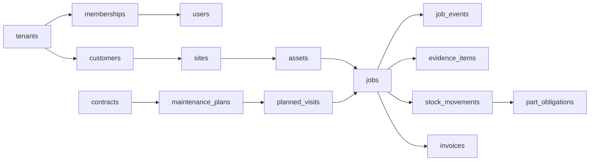
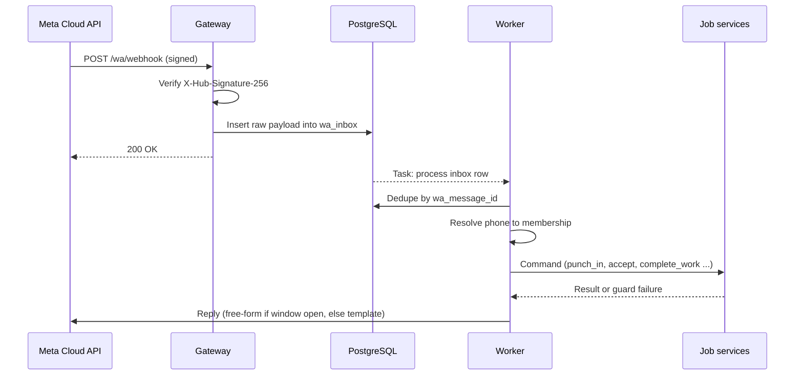
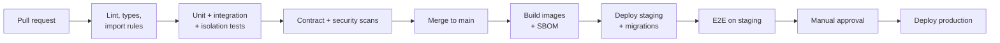

# Kritvo — Low-Level Design (LLD)

| Field | Value |
| --- | --- |
| **Version** | 1.2 |
| **Status** | Draft for review |
| **Last updated** | 2026-09-17 |
| **Owner** | Project lead |
| **Companion** | [HLD](HLD.md) · [Architecture summary](ARCHITECTURE.md) · [ADRs](../adr/README.md) |
| **Implements** | HLD v2.0 |

> Source of truth: this file on `main`. Change it only through a pull request that bumps **Version** and adds a row to the Revision history at the end.

This LLD implements the Kritvo HLD v2.0 for the MVP and names the Phase 2 extension points.

## 1. Scope, conventions and repository layout

Two repositories (ADR-0006): `kritvo-api` holds the backend, infrastructure and all documentation; `kritvo-web` holds the UI. The API is one Python package split into modules that only talk through service interfaces.

### 1.1 Repositories

| Repository | Contents | Deploys to |
| --- | --- | --- |
| `kritvo-api` | FastAPI app, WhatsApp gateway, worker, Alembic migrations, templates (JSON), PDF layouts; `openapi/` contract; `infra/` Terraform; `docs/` (HLD, LLD, ADRs, plans, status) | Container images: `api`, `gateway`, `worker`; AWS via Terraform |
| `kritvo-web` | React office app, technician PWA, client portal (one Vite app, three route trees) | CDN |

- **Checkout layout:** clone both repositories side by side (`~/code/kritvo/kritvo-api`, `~/code/kritvo/kritvo-web`). The web repository's Claude Code settings grant read access to `../kritvo-api/docs` and `../kritvo-api/openapi`.
- **API contract:** `kritvo-api` commits `openapi/openapi.json`, and its CI fails if the file is stale. `kritvo-web` generates its TypeScript types from that file; an optional CI job checks for drift.
- **Cross-repository changes:** change the API first in a backward-compatible way, merge it, then change the web app; both PRs carry the same task ID.
- **Infrastructure** stays in `kritvo-api/infra` until a separate operations owner justifies its own repository.

### 1.2 `kritvo-api` layout

```text
kritvo-api/
  src/kritvo/
    main_api.py            # FastAPI app for web, PWA, portal
    main_gateway.py        # FastAPI app for WhatsApp webhooks + Flow endpoint
    main_worker.py         # task worker + scheduler leader
    core/                  # settings, db session, tenancy context, errors, ids, clock
    shared/                # money, phone, geo (haversine), json-schema helpers
    modules/
      identity/            # each module: api.py, service.py, models.py, schemas.py, events.py, tasks.py
      tenancy/
      catalog/
      customers/
      assets/
      jobs/
      dispatch/
      attendance/
      evidence/
      inventory/
      contracts/
      billing/
      expenses/
      notifications/
      whatsapp/
      reports/
      portal/
      platform_billing/
      audit/
  templates/               # industry template bundles (dg_sets.json, solar.json ...)
  migrations/              # Alembic
  openapi/                 # committed openapi.json (API contract for kritvo-web)
  infra/                   # Terraform
  docs/                    # HLD, LLD, ADRs, plans, status, reviews
  scripts/                 # repository helpers
  tests/
    unit/  integration/  isolation/  contract/
```

### 1.3 Conventions

- **IDs:** UUIDv7 (time-ordered) for all primary keys; human-readable numbers (`JOB-2026-000123`) generated per tenant for display.
- **Time:** store `timestamptz` in UTC; display in the tenant's time zone (default `Asia/Kolkata`).
- **Money:** integer paise (`bigint`) plus currency code; never floats.
- **Phones:** E.164 strings; stored encrypted, searched by a keyed hash.
- **Soft delete:** `deleted_at`, `deleted_by` on master data; events and ledgers are never deleted.
- **Optimistic locking:** `version int` on office-editable rows; updates must send the version they read.
- **Module rules:** a module imports only `core`, `shared` and other modules' `service.py`; enforced by `import-linter` in CI.
- **Style:** Ruff (lint + format), mypy strict on `modules/*/service.py`, pytest; TypeScript strict, ESLint, Prettier on the web side.
- **Library choices to confirm in spikes:** background queue (Procrastinate or Celery), WhatsApp client (thin in-house `httpx` client vs. pywa), PDF rendering (WeasyPrint). Check maintenance status and licence before adopting.

## 2. Tenant isolation with row-level security

Every transaction opened by the app sets `app.tenant_id`, and PostgreSQL policies on every tenant table refuse rows from any other tenant, so a missing `WHERE tenant_id = ...` can never leak data.

### 2.1 Database roles

| Role | Used by | RLS |
| --- | --- | --- |
| `kritvo_owner` | Alembic migrations only; owns all tables | Not used at runtime |
| `kritvo_app` | API, gateway and tenant-scoped worker tasks | Enforced (`NOBYPASSRLS`, tables use `FORCE`) |
| `kritvo_system` | Scheduler fan-out, platform billing, signup; only in `platform_*` code paths | Bypasses RLS; every use is audited |

### 2.2 Policy pattern

```sql
-- migrations/versions/0001_tenancy_helpers.sql
CREATE FUNCTION app_tenant_id() RETURNS uuid
  LANGUAGE sql STABLE AS
$$ SELECT nullif(current_setting('app.tenant_id', true), '')::uuid $$;

CREATE FUNCTION app_customer_id() RETURNS uuid
  LANGUAGE sql STABLE AS
$$ SELECT nullif(current_setting('app.customer_id', true), '')::uuid $$;

-- applied to every table that has tenant_id (Alembic helper enable_tenant_rls(table))
ALTER TABLE jobs ENABLE ROW LEVEL SECURITY;
ALTER TABLE jobs FORCE ROW LEVEL SECURITY;

CREATE POLICY tenant_isolation ON jobs
  USING (tenant_id = app_tenant_id())
  WITH CHECK (tenant_id = app_tenant_id());

-- extra, restrictive policy on tables the client portal can read
CREATE POLICY portal_scope ON jobs AS RESTRICTIVE
  USING (app_customer_id() IS NULL OR customer_id = app_customer_id());
```

`nullif(..., '')` matters: after a local setting ends, PostgreSQL can return an empty string instead of NULL, and the policy must then match nothing.

### 2.3 Setting the tenant per transaction

`set_config(..., true)` lasts only for the current transaction, so it is set on every transaction start, not once per request.

```python
# src/kritvo/core/db.py
from collections.abc import AsyncIterator
from uuid import UUID

from sqlalchemy import event, text
from sqlalchemy.ext.asyncio import AsyncSession, async_sessionmaker, create_async_engine
from sqlalchemy.orm import Session

from kritvo.core.settings import settings

engine = create_async_engine(
    settings.database_url,  # postgresql+asyncpg://kritvo_app@...
    pool_pre_ping=True,
    # asyncpg behind PgBouncer in transaction mode needs the statement cache off
    connect_args={"statement_cache_size": 0},
)
SessionLocal = async_sessionmaker(engine, expire_on_commit=False)


class TenantContextMissing(RuntimeError):
    pass


@event.listens_for(Session, "after_begin")
def _apply_tenant_context(session: Session, transaction, connection) -> None:
    tenant_id: UUID | None = session.info.get("tenant_id")
    if tenant_id is None:
        raise TenantContextMissing("Session opened without tenant_id")
    connection.execute(
        text("select set_config('app.tenant_id', :tid, true)"),
        {"tid": str(tenant_id)},
    )
    customer_id: UUID | None = session.info.get("customer_id")
    connection.execute(
        text("select set_config('app.customer_id', :cid, true)"),
        {"cid": str(customer_id) if customer_id else ""},
    )


async def open_tenant_session(
    tenant_id: UUID, customer_id: UUID | None = None
) -> AsyncIterator[AsyncSession]:
    async with SessionLocal(info={"tenant_id": tenant_id, "customer_id": customer_id}) as session:
        yield session
```

```python
# src/kritvo/core/deps.py
from fastapi import Depends

from kritvo.core.db import open_tenant_session
from kritvo.modules.identity.service import Principal, get_principal


async def get_db(principal: Principal = Depends(get_principal)):
    async for session in open_tenant_session(principal.tenant_id, principal.portal_customer_id):
        yield session
```

Services own the unit of work (`async with session.begin(): ...`) and commit explicitly; the dependency never commits on teardown. System sessions use a separate engine bound to `kritvo_system` and are only importable from `platform_*` modules.

### 2.4 Isolation tests in CI

- **Coverage check:** fails the build if any table with a `tenant_id` column lacks RLS or FORCE.

```sql
SELECT c.relname
FROM pg_class c
JOIN pg_namespace n ON n.oid = c.relnamespace
JOIN pg_attribute a ON a.attrelid = c.oid AND a.attname = 'tenant_id' AND NOT a.attisdropped
WHERE n.nspname = 'public'
  AND c.relkind IN ('r', 'p')
  AND (NOT c.relrowsecurity OR NOT c.relforcerowsecurity);
-- must return zero rows
```

- **Behaviour check:** seed tenants A and B with rows in every table; with context A, `SELECT count(*)` on each table must equal A's count, and inserting a row with B's `tenant_id` must fail.
- **Portal check:** a portal session for customer X sees only X's jobs, assets and reports.
- **No-context check:** a session without `tenant_id` raises `TenantContextMissing` before any SQL runs.

## 3. Data model

The MVP needs about 30 tables in six groups; all tenant tables carry `tenant_id`, RLS (Section 2) and `created_at`, and field activity lives in append-only event and ledger tables.

### 3.1 Entity map



### 3.2 Core DDL (PostgreSQL 16+)

IDs are UUIDv7 generated in the application (PostgreSQL 18 also offers `uuidv7()`). Common columns (`created_at`, `updated_at`, `created_by`, `version`, `deleted_at`) are shown once and implied elsewhere.

```sql
-- ===== Identity and tenancy =====
CREATE TABLE tenants (
  id uuid PRIMARY KEY,
  name text NOT NULL,
  slug text UNIQUE NOT NULL,
  gstin text,
  timezone text NOT NULL DEFAULT 'Asia/Kolkata',
  plan_code text NOT NULL DEFAULT 'free',
  settings jsonb NOT NULL DEFAULT '{}',          -- validated by JSON Schema
  status text NOT NULL DEFAULT 'active',         -- active | suspended | closed
  created_at timestamptz NOT NULL DEFAULT now(),
  updated_at timestamptz NOT NULL DEFAULT now(),
  version int NOT NULL DEFAULT 1
);
ALTER TABLE tenants ENABLE ROW LEVEL SECURITY;
ALTER TABLE tenants FORCE ROW LEVEL SECURITY;
CREATE POLICY own_tenant ON tenants USING (id = app_tenant_id());   -- signup runs as kritvo_system

CREATE TABLE users (
  id uuid PRIMARY KEY,
  full_name text NOT NULL,
  phone_enc bytea NOT NULL,                      -- encrypted E.164
  phone_hash bytea UNIQUE NOT NULL,              -- HMAC for lookup
  email citext UNIQUE,
  password_hash text,                            -- owners/admins only (argon2id)
  totp_secret_enc bytea,
  preferred_lang text NOT NULL DEFAULT 'hi',
  created_at timestamptz NOT NULL DEFAULT now()
);                                               -- global identity, no tenant_id
-- a tenant session may only see users who are members of that tenant
ALTER TABLE users ENABLE ROW LEVEL SECURITY;
ALTER TABLE users FORCE ROW LEVEL SECURITY;
CREATE POLICY users_via_membership ON users USING (
  EXISTS (SELECT 1 FROM memberships m
          WHERE m.user_id = users.id AND m.tenant_id = app_tenant_id()));
-- login lookups by phone_hash run through a SECURITY DEFINER function owned by kritvo_owner

CREATE TABLE roles (
  id uuid PRIMARY KEY,
  tenant_id uuid NOT NULL REFERENCES tenants(id),
  name text NOT NULL,
  permissions text[] NOT NULL,                   -- codes from the catalogue (Section 12)
  is_system boolean NOT NULL DEFAULT false,
  UNIQUE (tenant_id, name)
);

CREATE TABLE memberships (
  id uuid PRIMARY KEY,
  tenant_id uuid NOT NULL REFERENCES tenants(id),
  user_id uuid NOT NULL REFERENCES users(id),
  role_id uuid NOT NULL REFERENCES roles(id),
  kind text NOT NULL,                            -- office | field | portal
  branch_id uuid,
  employee_code text,
  portal_customer_id uuid,                       -- set only for kind = portal
  whatsapp_opt_in_at timestamptz,
  privacy_notice_ack_at timestamptz,
  status text NOT NULL DEFAULT 'active',
  UNIQUE (tenant_id, user_id)
);

CREATE TABLE devices (
  id uuid PRIMARY KEY,
  tenant_id uuid NOT NULL REFERENCES tenants(id),
  user_id uuid NOT NULL REFERENCES users(id),
  fingerprint text NOT NULL,
  platform text NOT NULL,                        -- pwa | android | whatsapp
  first_seen_at timestamptz NOT NULL DEFAULT now(),
  last_seen_at timestamptz NOT NULL DEFAULT now(),
  UNIQUE (tenant_id, user_id, fingerprint)
);

-- ===== Customers, sites, assets =====
CREATE TABLE customers (
  id uuid PRIMARY KEY,
  tenant_id uuid NOT NULL REFERENCES tenants(id),
  name text NOT NULL,
  gstin text,
  billing_address jsonb,
  contact_phone_enc bytea,
  contact_phone_hash bytea,
  custom jsonb NOT NULL DEFAULT '{}'
);

CREATE TABLE sites (
  id uuid PRIMARY KEY,
  tenant_id uuid NOT NULL REFERENCES tenants(id),
  customer_id uuid NOT NULL REFERENCES customers(id),
  name text NOT NULL,
  address jsonb,
  lat double precision NOT NULL,
  lng double precision NOT NULL,
  geofence_radius_m int NOT NULL DEFAULT 150 CHECK (geofence_radius_m BETWEEN 30 AND 2000),
  site_contact_phone_enc bytea
);

CREATE TABLE asset_types (
  id uuid PRIMARY KEY,
  tenant_id uuid NOT NULL REFERENCES tenants(id),
  code text NOT NULL,                            -- dg_set, ups, solar_inverter ...
  name text NOT NULL,
  field_schema jsonb NOT NULL,                   -- JSON Schema for assets.attributes
  schema_version int NOT NULL DEFAULT 1,
  UNIQUE (tenant_id, code)
);

CREATE TABLE assets (
  id uuid PRIMARY KEY,
  tenant_id uuid NOT NULL REFERENCES tenants(id),
  site_id uuid NOT NULL REFERENCES sites(id),
  customer_id uuid NOT NULL REFERENCES customers(id),  -- denormalised for portal policy
  asset_type_id uuid NOT NULL REFERENCES asset_types(id),
  serial_no text,
  make text, model text,
  installed_on date,
  running_hours numeric(10,1),
  attributes jsonb NOT NULL DEFAULT '{}',
  qr_code text UNIQUE,
  status text NOT NULL DEFAULT 'active'
);

-- ===== Jobs =====
CREATE TABLE job_types (
  id uuid PRIMARY KEY,
  tenant_id uuid NOT NULL REFERENCES tenants(id),
  code text NOT NULL,                            -- breakdown, pm_visit, installation
  name text NOT NULL,
  workflow_id uuid NOT NULL,                     -- -> workflows (Section 4)
  checklist_id uuid,
  default_sla_minutes int,
  UNIQUE (tenant_id, code)
);

CREATE TABLE jobs (
  id uuid PRIMARY KEY,
  tenant_id uuid NOT NULL REFERENCES tenants(id),
  number text NOT NULL,                          -- JOB-2026-000123
  job_type_id uuid NOT NULL REFERENCES job_types(id),
  workflow_version_id uuid NOT NULL,             -- pinned at creation
  customer_id uuid NOT NULL REFERENCES customers(id),
  site_id uuid NOT NULL REFERENCES sites(id),
  asset_id uuid REFERENCES assets(id),
  planned_visit_id uuid,
  priority smallint NOT NULL DEFAULT 3,          -- 1 highest
  state text NOT NULL,                           -- projection of job_events
  reported_issue text,
  scheduled_start timestamptz,
  due_by timestamptz,
  risk_score smallint NOT NULL DEFAULT 0,
  verified_by_method text,                       -- customer_otp | signature | supervisor
  closed_at timestamptz,
  custom jsonb NOT NULL DEFAULT '{}',
  version int NOT NULL DEFAULT 1,
  created_at timestamptz NOT NULL DEFAULT now(),
  UNIQUE (tenant_id, number)
);
CREATE INDEX jobs_open_idx ON jobs (tenant_id, state, scheduled_start) WHERE closed_at IS NULL;

CREATE TABLE job_assignments (
  tenant_id uuid NOT NULL REFERENCES tenants(id),
  job_id uuid NOT NULL REFERENCES jobs(id),
  user_id uuid NOT NULL REFERENCES users(id),
  role text NOT NULL DEFAULT 'lead',             -- lead | helper
  assigned_by uuid NOT NULL,
  assigned_at timestamptz NOT NULL DEFAULT now(),
  unassigned_at timestamptz,
  PRIMARY KEY (job_id, user_id, assigned_at)
);

CREATE TABLE job_events (                        -- append-only; partition by month later
  id uuid PRIMARY KEY,
  tenant_id uuid NOT NULL REFERENCES tenants(id),
  job_id uuid NOT NULL REFERENCES jobs(id),
  kind text NOT NULL,                            -- transition | note | checklist | part_used | reading
  from_state text, to_state text,
  payload jsonb NOT NULL DEFAULT '{}',
  actor_id uuid NOT NULL,
  on_behalf_of uuid,                             -- crew mode
  channel text NOT NULL,                         -- whatsapp | pwa | web | system
  client_op_id uuid,                             -- idempotency from offline/WhatsApp
  captured_at timestamptz,                       -- device time
  received_at timestamptz NOT NULL DEFAULT now(),-- server time
  lat double precision, lng double precision, accuracy_m real,
  risk_score smallint NOT NULL DEFAULT 0,
  risk_reasons text[] NOT NULL DEFAULT '{}',
  UNIQUE (tenant_id, client_op_id)
);
CREATE INDEX job_events_job_idx ON job_events (job_id, received_at);

-- ===== Evidence and attendance =====
CREATE TABLE evidence_items (
  id uuid PRIMARY KEY,
  tenant_id uuid NOT NULL REFERENCES tenants(id),
  subject_type text NOT NULL,                    -- job | attendance | expense | part
  subject_id uuid NOT NULL,
  kind text NOT NULL,                            -- photo_before | photo_after | part_new | part_old | selfie | signature | receipt
  storage_key text NOT NULL,
  sha256 bytea NOT NULL,
  phash bigint,                                  -- 64-bit perceptual hash
  source text NOT NULL,                          -- wa_flow_camera | pwa_camera | upload
  scan_status text NOT NULL DEFAULT 'pending',   -- pending | clean | infected
  captured_at timestamptz,
  received_at timestamptz NOT NULL DEFAULT now(),
  lat double precision, lng double precision,
  uploaded_by uuid NOT NULL,
  retention_until date
);
CREATE INDEX evidence_phash_idx ON evidence_items (tenant_id, phash);

CREATE TABLE attendance_sessions (
  id uuid PRIMARY KEY,
  tenant_id uuid NOT NULL REFERENCES tenants(id),
  user_id uuid NOT NULL REFERENCES users(id),
  work_date date NOT NULL,
  policy text NOT NULL,                          -- site_geofence | office_geofence | free_flagged
  in_event jsonb NOT NULL,                       -- {captured_at, received_at, lat, lng, accuracy, selfie_id, site_id}
  out_event jsonb,
  risk_score smallint NOT NULL DEFAULT 0,
  risk_reasons text[] NOT NULL DEFAULT '{}',
  status text NOT NULL DEFAULT 'pending',        -- auto_accepted | pending | approved | rejected | flagged
  reviewed_by uuid,
  reviewed_at timestamptz,
  review_note text,
  CHECK (reviewed_by IS NULL OR reviewed_by <> user_id)
);
CREATE INDEX attendance_day_idx ON attendance_sessions (tenant_id, work_date, status);

-- ===== Inventory (details in Section 9) =====
CREATE TABLE items (
  id uuid PRIMARY KEY,
  tenant_id uuid NOT NULL REFERENCES tenants(id),
  sku text NOT NULL,
  name text NOT NULL,
  uom text NOT NULL DEFAULT 'nos',               -- nos | litre | metre | kg
  is_serialised boolean NOT NULL DEFAULT false,
  requires_return boolean NOT NULL DEFAULT false,
  return_sla_hours int NOT NULL DEFAULT 48,
  unit_cost_paise bigint,
  hsn_code text,
  UNIQUE (tenant_id, sku)
);

CREATE TABLE stock_locations (
  id uuid PRIMARY KEY,
  tenant_id uuid NOT NULL REFERENCES tenants(id),
  kind text NOT NULL,                            -- warehouse | technician | site | scrap | vendor | adjustment
  ref_id uuid,                                   -- user_id for technician, site_id for site
  name text NOT NULL
);

-- ===== Contracts =====
CREATE TABLE contracts (
  id uuid PRIMARY KEY,
  tenant_id uuid NOT NULL REFERENCES tenants(id),
  customer_id uuid NOT NULL REFERENCES customers(id),
  number text NOT NULL,
  kind text NOT NULL,                            -- comprehensive_amc | non_comprehensive_amc | warranty
  starts_on date NOT NULL,
  ends_on date NOT NULL CHECK (ends_on > starts_on),
  value_paise bigint,
  status text NOT NULL DEFAULT 'active'
);

CREATE TABLE maintenance_plans (
  id uuid PRIMARY KEY,
  tenant_id uuid NOT NULL REFERENCES tenants(id),
  contract_id uuid NOT NULL REFERENCES contracts(id),
  asset_id uuid NOT NULL REFERENCES assets(id),
  job_type_id uuid NOT NULL REFERENCES job_types(id),
  every_days int CHECK (every_days > 0),
  every_running_hours int CHECK (every_running_hours > 0),
  lead_days int NOT NULL DEFAULT 7,
  CHECK (every_days IS NOT NULL OR every_running_hours IS NOT NULL)
);

CREATE TABLE planned_visits (
  id uuid PRIMARY KEY,
  tenant_id uuid NOT NULL REFERENCES tenants(id),
  plan_id uuid NOT NULL REFERENCES maintenance_plans(id),
  due_on date NOT NULL,
  due_at_hours numeric(10,1),
  job_id uuid REFERENCES jobs(id),
  status text NOT NULL DEFAULT 'planned',        -- planned | job_created | done | overdue | skipped
  UNIQUE (plan_id, due_on)
);

-- ===== WhatsApp and metering =====
CREATE TABLE wa_messages (                       -- inbound + outbound log; partition by month later
  id uuid PRIMARY KEY,
  tenant_id uuid REFERENCES tenants(id),         -- null until the sender is resolved
  direction text NOT NULL,                       -- in | out
  wa_message_id text NOT NULL UNIQUE,
  phone_hash bytea NOT NULL,
  type text NOT NULL,                            -- text | interactive | image | location | template | flow
  template_name text,
  pricing_category text,                         -- from status webhooks
  billable boolean,
  cost_micros bigint,                            -- estimated INR micro-units from rate table
  status text,                                   -- sent | delivered | read | failed
  job_id uuid,
  payload jsonb NOT NULL,
  created_at timestamptz NOT NULL DEFAULT now()
);

-- ===== Idempotency, audit =====
CREATE TABLE idempotency_keys (
  tenant_id uuid NOT NULL REFERENCES tenants(id),
  key uuid NOT NULL,
  request_hash bytea NOT NULL,
  response jsonb,
  created_at timestamptz NOT NULL DEFAULT now(),
  PRIMARY KEY (tenant_id, key)
);

CREATE TABLE audit_log (
  id bigint GENERATED ALWAYS AS IDENTITY PRIMARY KEY,
  tenant_id uuid,
  table_name text NOT NULL,
  record_id uuid NOT NULL,
  action text NOT NULL,                          -- INSERT | UPDATE | DELETE
  old_row jsonb, new_row jsonb,
  actor_id uuid,                                 -- from current_setting('app.actor_id')
  at timestamptz NOT NULL DEFAULT now(),
  prev_hash bytea,
  row_hash bytea NOT NULL
);
REVOKE UPDATE, DELETE ON audit_log FROM kritvo_app;
```

### 3.3 Other tables (same patterns)

| Table | Purpose |
| --- | --- |
| `branches` | Branch name, address, GSTIN, invoice series |
| `workflows`, `workflow_versions` | Workflow definitions (Section 4) |
| `checklists`, `checklist_versions` | Checklist definitions per job type |
| `serial_units`, `stock_balances`, `stock_movements`, `part_obligations` | Inventory ledger (Section 9) |
| `quotes`, `invoices`, `invoice_lines`, `payments` | Billing (Section 11) |
| `expenses` | Claims with receipt evidence and approval |
| `wa_sessions` | Per-phone conversation state (Section 6) |
| `notification_prefs`, `outbound_messages` | Channel preferences and queued sends |
| `sync_ops` | Processed offline operations (Section 7) |
| `plans`, `subscriptions`, `usage_counters`, `platform_invoices` | Kritvo's own billing |

### 3.4 Audit trigger

One trigger function is attached to critical tables (`jobs`, `attendance_sessions`, `stock_movements`, `invoices`, `roles`, `memberships`). It writes old and new rows, reads the actor from `app.actor_id` (set like the tenant), and chains `row_hash = sha256(prev_hash || new_row)` per tenant using an advisory lock on the tenant to keep the chain ordered. A nightly job verifies each tenant's chain and alerts on a break.

## 4. Configuration: templates, custom fields and workflow engine

Tenants configure states, fields and checklists as versioned JSON, but guards and side effects are a fixed code registry, so configuration can change behaviour only in ways the team has written and tested.

### 4.1 Workflow definition

```json
{
  "code": "breakdown_default",
  "version": 3,
  "states": [
    {"code": "NEW", "locked": true},
    {"code": "ASSIGNED"}, {"code": "ACCEPTED"}, {"code": "TRAVELLING"},
    {"code": "ON_SITE"}, {"code": "IN_PROGRESS"}, {"code": "ON_HOLD"},
    {"code": "WORK_DONE", "locked": true},
    {"code": "VERIFIED", "locked": true},
    {"code": "INVOICED"},
    {"code": "CLOSED", "locked": true, "terminal": true},
    {"code": "CANCELLED", "terminal": true}
  ],
  "transitions": [
    {
      "action": "complete_work",
      "from": "IN_PROGRESS",
      "to": "WORK_DONE",
      "permission": "job.update_assigned",
      "channels": ["whatsapp", "pwa", "web"],
      "guards": [
        {"type": "checklist_complete"},
        {"type": "evidence_min", "kind": "photo_after", "count": 1,
         "sources": ["wa_flow_camera", "pwa_camera"]},
        {"type": "parts_recorded"}
      ],
      "effects": [
        {"type": "create_part_obligations"},
        {"type": "send_customer_otp", "template": "job_done_otp"}
      ]
    },
    {
      "action": "verify",
      "from": "WORK_DONE",
      "to": "VERIFIED",
      "permission": "job.update_assigned",
      "guards": [{"type": "verification_any", "methods": ["customer_otp", "signature", "supervisor"]}],
      "effects": [{"type": "render_service_report"}, {"type": "send_customer_report"}]
    }
  ]
}
```

### 4.2 Transition algorithm

```python
# src/kritvo/modules/jobs/service.py  (sketch)
async def transition(session, *, job_id, action, actor, channel, data, client_op_id, captured_at, geo):
    async with session.begin():
        if client_op_id and await events_repo.exists(session, client_op_id):
            return await events_repo.result_for(session, client_op_id)      # idempotent replay

        job = await jobs_repo.get_for_update(session, job_id)                # SELECT ... FOR UPDATE
        wf = await workflows.get_version(session, job.workflow_version_id)
        t = wf.find(action=action, from_state=job.state)
        if t is None:
            raise Conflict("INVALID_TRANSITION", state=job.state, action=action)

        authz.require(actor, t.permission, job=job)                           # also checks assignment
        if channel not in t.channels:
            raise Forbidden("CHANNEL_NOT_ALLOWED")

        failures = [f for g in t.guards if (f := await GUARDS[g.type](session, job, g, data))]
        if failures:
            raise Unprocessable("GUARD_FAILED", failures=failures)             # codes shown to user in their language

        risk = await evidence.score_event(session, actor=actor, job=job, geo=geo, captured_at=captured_at)
        event = await events_repo.append(session, job, t, actor, channel, data, client_op_id,
                                         captured_at, geo, risk)
        await jobs_repo.set_state(session, job, t.to_state, expected_version=job.version)
        await outbox.enqueue(session, [e.for_event(event) for e in t.effects])  # transactional outbox
    return event
```

- **Guards** are pure checks registered in code: `checklist_complete`, `evidence_min`, `parts_recorded`, `verification_any`, `no_overdue_obligations`, `reason_required`, `invoice_issued`.
- **Effects** run in the worker from a `domain_events` outbox table, so a WhatsApp or PDF failure never rolls back the job update; each effect is idempotent by `(event_id, effect_type)`.
- **Versioning:** `workflow_versions` rows are immutable. Publishing a new version affects new jobs only; open jobs keep their pinned version.

### 4.3 Publish-time validation

A workflow version is rejected unless:

1. All four locked states exist and keep their fixed meaning.
2. Every state is reachable from NEW, and CLOSED or CANCELLED is reachable from every non-terminal state.
3. Every guard and effect type exists in the registry, with valid parameters (JSON Schema per type).
4. Every permission code exists in the catalogue.
5. A dry run over the last 50 closed jobs of that type replays without errors (warning only).

### 4.4 Custom fields and checklists

- Asset attributes and job custom fields use a restricted JSON Schema dialect: `string`, `number`, `integer`, `boolean`, `date`, `enum`, plus Kritvo types `reading` (number + unit + min/max) and `photo` (evidence reference). UI hints live in `x-ui` (label per language, order, help text).
- Server validation uses a JSON Schema validator; the web app renders forms from the same schema.
- Filterable fields get a GIN index on the `custom` or `attributes` column; if a field becomes a hot filter, promote it to a generated column with a B-tree index.
- Checklist items: `check`, `reading`, `text`, `select`, `photo`; each has `required` and an optional `on_fail` action (`flag_job`, `create_followup_job`, `notify_supervisor`).
- Checklists longer than about 15 items are marked `pwa_only` for WhatsApp, which then sends a link instead of a Flow.

### 4.5 Template bundles

```text
templates/dg_sets.json
  meta:            {code, name, version, languages}
  asset_types:     [dg_set, amf_panel, battery_bank]
  job_types:       [breakdown, pm_visit, installation, commissioning]
  workflows:       [breakdown_default, pm_default]
  checklists:      [pm_visit_dg, breakdown_dg, commissioning_dg]
  items:           [engine_oil, oil_filter, fuel_filter, air_filter, coolant, battery_12v, ...]
  plan_defaults:   {pm_visit: {every_days: 90, every_running_hours: 250, lead_days: 7}}
  wa_copy:         {hi: {...}, en: {...}}
```

Intervals and part lists above are placeholders; Rahul Electricals must supply the real values before the template is published. Import is idempotent by `code`: re-importing a newer template version adds new objects and leaves tenant edits alone; a tenant can fork any object.

## 5. API design

One REST API under `/api/v1` serves the web app, PWA and portal; commands that change job state are explicit action endpoints rather than generic PATCHes, so the workflow engine always runs.

### 5.1 Conventions

| Topic | Rule |
| --- | --- |
| Versioning | `/api/v1/...`; breaking changes go to `/v2` with 6 months of overlap |
| Tenant | Taken from the access token, never from the URL or body |
| Errors | RFC 9457 problem details: `{"type", "title", "status", "code", "detail", "errors": [{"field", "code"}]}`; `code` is stable and translated on the client |
| Pagination | Cursor based: `?limit=50&cursor=...` returns `{items, next_cursor}`; totals only where cheap |
| Filtering | `?state=IN_PROGRESS&site_id=...&updated_since=...`; custom fields via `?custom.kva_rating=125` for indexed fields only |
| Concurrency | `ETag` = row version; updates require `If-Match`; mismatch returns 412 |
| Idempotency | `Idempotency-Key` header required on every POST that creates or changes something; stored 24 hours with the response |
| Time | ISO 8601 with offset; clients send `captured_at` for field actions |
| Files | `POST /uploads` returns a presigned PUT URL and an `upload_id`; the client then references `upload_id` |
| Client SDK | `kritvo-api` commits `openapi/openapi.json` (CI fails if stale); `kritvo-web` generates TypeScript types from it, and its contract job fails on drift or removed fields |

### 5.2 Endpoints (MVP)

| Area | Method and path | Notes |
| --- | --- | --- |
| Auth | `POST /auth/otp/request`, `POST /auth/otp/verify` | Field and portal login; rate-limited per phone and device |
| Auth | `POST /auth/login`, `POST /auth/totp/verify` | Owners and admins |
| Auth | `POST /auth/refresh`, `POST /auth/logout`, `POST /auth/switch-tenant` | Rotating refresh cookie |
| Tenancy | `POST /signup` (public), `GET/PATCH /tenant`, `POST /tenant/templates/{code}/import` | Signup runs as system role |
| Users | `GET/POST /members`, `PATCH /members/{id}`, `GET/POST /roles`, `PATCH /roles/{id}` | Invite sends WhatsApp opt-in and notice |
| Customers | `GET/POST /customers`, `GET/PATCH /customers/{id}`, `GET/POST /customers/{id}/sites` |  |
| Assets | `GET/POST /assets`, `GET/PATCH /assets/{id}`, `GET /assets/{id}/history`, `GET/POST /asset-types` |  |
| Imports | `POST /imports` (xlsx or csv), `GET /imports/{id}` | Dry run first, then commit |
| Jobs | `GET/POST /jobs`, `GET/PATCH /jobs/{id}` | PATCH only edits office fields, never state |
| Jobs | `POST /jobs/{id}/actions/{action}` | Runs the workflow engine (Section 4.2) |
| Jobs | `POST /jobs/{id}/assignments`, `DELETE /jobs/{id}/assignments/{user_id}` |  |
| Jobs | `POST /jobs/{id}/evidence`, `POST /jobs/{id}/checklist`, `POST /jobs/{id}/readings` |  |
| Jobs | `POST /jobs/{id}/verification/otp`, `POST /jobs/{id}/verification/otp/confirm` | Customer OTP |
| Dispatch | `GET /dispatch/board?date=...`, `GET /dispatch/technicians` | Board of jobs by technician |
| Attendance | `POST /attendance/punch-in`, `POST /attendance/punch-out`, `GET /attendance?date=...`, `POST /attendance/{id}/review` | Review forbidden on own record |
| Inventory | `GET/POST /items`, `GET /stock?location_id=...`, `POST /stock/receipts`, `POST /stock/issues`, `POST /stock/returns`, `POST /stock/adjustments`, `GET /obligations?status=open` | Section 9 |
| Contracts | `GET/POST /contracts`, `POST /contracts/{id}/plans`, `GET /planned-visits?due_before=...` |  |
| Expenses | `GET/POST /expenses`, `POST /expenses/{id}/review` |  |
| Reports | `GET /reports/owner-summary`, `GET /reports/parts-variance`, `GET /reports/amc-compliance`, `POST /reports/exports` | Exports run in the worker |
| Documents | `GET /jobs/{id}/service-report` | Redirects to a short-lived signed URL |
| Portal | `GET /portal/assets`, `GET /portal/jobs`, `GET /portal/reports/{job_id}` | Portal policy limits to one customer |
| Sync | `POST /sync/push`, `GET /sync/pull?cursor=...` | Section 7 |
| WhatsApp | `GET/POST /wa/webhook`, `POST /wa/flows/endpoint` | Served by the gateway process |
| Platform | `GET /billing/subscription`, `POST /billing/checkout` | Kritvo's own billing |
| Health | `GET /healthz`, `GET /readyz` | No auth, no data |

### 5.3 Example: completing work from the PWA

```http
POST /api/v1/jobs/0192f3a0-.../actions/complete_work
Authorization: Bearer <access token>
Idempotency-Key: 5b1e2c1a-7d7e-4f5e-9a51-0c2f5d3e9a10
Content-Type: application/json

{
  "client_op_id": "5b1e2c1a-7d7e-4f5e-9a51-0c2f5d3e9a10",
  "captured_at": "2026-09-17T11:42:05+05:30",
  "geo": {"lat": 28.5501, "lng": 77.5519, "accuracy_m": 18},
  "data": {
    "evidence_upload_ids": ["up_01J..."],
    "parts_used": [{"item_id": "...", "qty": 1, "serial": "FLT-88213", "old_part_serial": "FLT-11209"}],
    "notes": "Fuel filter replaced"
  }
}
```

```http
HTTP/1.1 422 Unprocessable Content
Content-Type: application/problem+json

{
  "type": "https://docs.kritvo.app/errors/guard-failed",
  "title": "Job cannot be completed yet",
  "status": 422,
  "code": "GUARD_FAILED",
  "errors": [{"field": "checklist", "code": "CHECKLIST_INCOMPLETE", "missing": ["coolant_level"]}]
}
```

The docs domain in the example is illustrative until the domain is registered.

## 6. WhatsApp integration

The gateway verifies, stores and queues every webhook in under a second; a worker resolves the sender, runs a small per-phone state machine, and calls the same job and attendance services the PWA uses.

### 6.1 Inbound pipeline



```python
# src/kritvo/modules/whatsapp/api.py
import hashlib
import hmac

from fastapi import APIRouter, Header, HTTPException, Request, Response

from kritvo.core.settings import settings
from kritvo.modules.whatsapp import inbox

router = APIRouter(prefix="/wa")


@router.get("/webhook")
async def verify_subscription(request: Request) -> Response:
    q = request.query_params
    if q.get("hub.mode") == "subscribe" and hmac.compare_digest(
        q.get("hub.verify_token", ""), settings.wa_verify_token
    ):
        return Response(content=q.get("hub.challenge", ""), media_type="text/plain")
    raise HTTPException(status_code=403)


@router.post("/webhook")
async def receive(request: Request, x_hub_signature_256: str = Header(default="")) -> Response:
    body = await request.body()  # raw bytes: the signature covers them exactly
    expected = "sha256=" + hmac.new(
        settings.wa_app_secret.encode(), body, hashlib.sha256
    ).hexdigest()
    if not hmac.compare_digest(expected, x_hub_signature_256):
        raise HTTPException(status_code=401)
    await inbox.store_and_enqueue(body)  # no parsing or business logic here
    return Response(status_code=200)
```

### 6.2 Sender resolution

1. Hash the sender's number with the phone HMAC key and look up active `field` memberships with WhatsApp opt-in (system role, then switch to the tenant context).
2. No match: reply once with a neutral message ("This number is not registered. Contact your company admin.") and store nothing beyond the log.
3. One match: continue in that tenant.
4. Several matches: ask once per day with a list message; remember the choice in the session.
5. Suspended tenant or member: reply with a neutral notice; no job data.

### 6.3 Conversation state

```sql
CREATE TABLE wa_sessions (
  phone_hash bytea PRIMARY KEY,
  tenant_id uuid,
  user_id uuid,
  state text NOT NULL DEFAULT 'IDLE',
  context jsonb NOT NULL DEFAULT '{}',   -- {job_id, awaiting, flow_token, lang}
  window_open_until timestamptz,          -- last inbound + 24h
  updated_at timestamptz NOT NULL DEFAULT now()
);                                        -- platform table, accessed by gateway code only
```

| State | Accepted input | Action | Next state |
| --- | --- | --- | --- |
| IDLE | "Start day" button, "hi", "1" | Send punch-in Flow | PUNCHING |
| PUNCHING | Flow reply (selfie + location) | `attendance.punch_in`; send today's job list | DAY\_STARTED |
| DAY\_STARTED | List pick of a job | Show job card with Accept, Directions, Help | JOB\_SELECTED |
| JOB\_SELECTED | Accept, On the way | `jobs.transition` | JOB\_SELECTED |
| JOB\_SELECTED | Reached site | Send location request | AWAITING\_LOCATION |
| AWAITING\_LOCATION | Location message | `jobs.transition(reach_site)` with geo | JOB\_SELECTED |
| JOB\_SELECTED | Start work | Send job-work Flow (checklist, photos, parts) | FLOW\_OPEN |
| FLOW\_OPEN | Flow reply | Evidence, checklist, parts; `complete_work`; OTP sent to customer | AWAITING\_OTP |
| AWAITING\_OTP | 4 to 6 digit text | `verify`; report sent | DAY\_STARTED |
| Any | "Help" | Share coordinator contact | unchanged |
| Any | "End day" | Punch-out Flow | IDLE |

Unexpected input gets the current state's buttons again, never an error wall. Sessions older than 12 hours of silence reset to DAY\_STARTED or IDLE.

### 6.4 Signed action IDs

Button and list reply IDs carry a compact signed token: `v1.<action>.<ref>.<exp>.<mac>` where `mac` is a truncated HMAC-SHA256 over the rest, keyed per environment. The worker rejects expired or forged IDs, so an old forwarded message cannot approve anything. Manager approvals (attendance, expenses) use the same scheme with a 24-hour expiry.

### 6.5 Flows

| Flow | Screens | Data endpoint needed |
| --- | --- | --- |
| `punch_in` | Selfie (photo picker, camera-only, 1 photo); confirm | No |
| `job_work` | Checklist; after photos (camera-only, 1 to 5); parts used (list from the technician's issued stock); notes | Yes: loads checklist and issued parts for this job |
| `part_return` | Pick obligations; photo of old part | Yes |
| `expense` (Phase 2) | Category, amount, receipt photo | No |

- `flow_token` is a signed token binding the Flow to `(tenant, user, job, expiry)`.
- The completed Flow arrives as an `interactive` webhook of type `nfm_reply` whose `response_json` holds the answers.
- Photos from the photo picker come as encrypted media references; the worker downloads, decrypts and verifies them per Meta's media-upload specification, then stores them as `evidence_items` with `source = wa_flow_camera`.
- The data endpoint answers Meta's `ping` health check and must respond quickly; it reads from the database only and never calls other external services.

```python
# src/kritvo/modules/whatsapp/flow_crypto.py
# Flow data endpoint encryption as described in Meta's Flows endpoint documentation;
# verify against the official example before release.
import base64
import json

from cryptography.hazmat.primitives import hashes
from cryptography.hazmat.primitives.asymmetric import padding
from cryptography.hazmat.primitives.asymmetric.rsa import RSAPrivateKey
from cryptography.hazmat.primitives.ciphers.aead import AESGCM


def decrypt_request(body: dict, private_key: RSAPrivateKey) -> tuple[dict, bytes, bytes]:
    aes_key = private_key.decrypt(
        base64.b64decode(body["encrypted_aes_key"]),
        padding.OAEP(mgf=padding.MGF1(algorithm=hashes.SHA256()), algorithm=hashes.SHA256(), label=None),
    )
    iv = base64.b64decode(body["initial_vector"])
    plaintext = AESGCM(aes_key).decrypt(iv, base64.b64decode(body["encrypted_flow_data"]), None)
    return json.loads(plaintext), aes_key, iv


def encrypt_response(payload: dict, aes_key: bytes, iv: bytes) -> str:
    flipped_iv = bytes(b ^ 0xFF for b in iv)
    ciphertext = AESGCM(aes_key).encrypt(flipped_iv, json.dumps(payload).encode(), None)
    return base64.b64encode(ciphertext).decode()  # returned as a plain-text response body
```

### 6.6 Message templates (MVP)

| Name | Recipient | Category (Meta decides) | Variables |
| --- | --- | --- | --- |
| `staff_new_job` | Technician | Utility | job number, site, time; button "View" |
| `staff_day_start` | Technician | Utility | name, jobs today; button "Start day" |
| `staff_part_return_due` | Technician | Utility | part, job, due time |
| `manager_review_needed` | Coordinator | Utility | count, oldest item; buttons Approve or Open |
| `owner_daily_summary` | Owner | Utility | jobs done, overdue AMC, flagged punches, parts in field |
| `cust_job_booked` | Customer | Utility | job number, asset, expected date |
| `cust_tech_on_way` | Customer | Utility | technician first name, ETA window |
| `cust_job_done_otp` | Customer | Likely authentication | OTP, job number |
| `cust_service_report` | Customer | Utility | document header (PDF), job number |
| `login_otp` | Any user | Authentication | OTP |

Each template exists in Hindi and English; tenant name is a variable while Kritvo uses one shared number.

### 6.7 Outbound sender

- One task per message with an idempotency key; retries with exponential backoff on 429 and 5xx; permanent errors mark the message failed and alert.
- Before sending free-form text, check `window_open_until`; if closed, send the matching template instead. If Meta still reports a re-engagement error, fall back to the template once.
- Per-number throughput limit and a per-tenant daily cap protect account quality.
- Media (PDF reports) is uploaded to Meta once and referenced by media ID.

### 6.8 Metering

- Status webhooks include a `pricing` object (`billable`, `category`, `type`); store them on `wa_messages`.
- `wa_rates(market, category, effective_from, rate_micros)` holds Meta's rate card; cost = rate at send date for billable messages.
- `usage_counters` aggregate per tenant per month for dashboards and fair-use billing.
- Alert if a tenant's billable share of messages jumps week over week (a sign of broken window handling or a pricing change).

### 6.9 Phase 2: tenant-owned numbers

`wa_accounts(tenant_id, waba_id, phone_number_id, token_secret_ref, status)`. Webhooks are routed by `metadata.phone_number_id`; customer-facing templates then go from the tenant's own number, and Meta bills that account.

## 7. PWA offline sync protocol

The PWA writes every field action to an IndexedDB outbox first, uploads photos before the operations that reference them, and pushes operations in device order; the server applies each exactly once and answers per operation.

### 7.1 Client storage

| Store | Contents | Cleared |
| --- | --- | --- |
| `snapshot` | Today's and tomorrow's assigned jobs, their sites, assets, checklists, the user's issued stock, item names | On logout, or after 7 days without login |
| `outbox` | Operations `{op_id, device_seq, entity, action, target_id, payload, captured_at, geo, upload_refs, attempts, status}` | When the server returns applied, duplicate or rejected (after the user sees it) |
| `blobs` | Compressed photos (long edge 1600 px, JPEG quality about 0.7) awaiting upload | After upload is confirmed |
| `meta` | `device_id`, pull cursor, last sync time | On logout |

The app calls `navigator.storage.persist()` at first login and warns when the quota estimate drops below 50 MB. Offline-capable screens show the outbox count ("3 actions waiting to sync").

### 7.2 Push

```http
POST /api/v1/sync/push
{
  "device_id": "dev_...",
  "ops": [
    {"op_id": "...", "device_seq": 41, "entity": "job", "action": "reach_site",
     "target_id": "...", "captured_at": "...", "geo": {...}, "payload": {}},
    {"op_id": "...", "device_seq": 42, "entity": "job", "action": "complete_work",
     "target_id": "...", "captured_at": "...", "payload": {"evidence_upload_ids": ["up_..."]}}
  ]
}
```

```json
{
  "results": [
    {"op_id": "...", "status": "applied", "server_version": 7},
    {"op_id": "...", "status": "rejected", "code": "GUARD_FAILED", "errors": [{"code": "CHECKLIST_INCOMPLETE"}]}
  ],
  "next_pull_cursor": "..."
}
```

- Batches hold at most 50 operations or 1 MB.
- The server processes operations in `device_seq` order within a device and records each in `sync_ops(tenant_id, op_id PRIMARY KEY, device_id, result)`; a repeated `op_id` returns the stored result as `duplicate`.
- If an operation is rejected, later operations on the same target in that batch return `DEPENDENCY_FAILED` and stay visible to the technician with a fix-it prompt.
- An operation that references an upload not yet confirmed returns `UPLOAD_PENDING` and is retried after the upload.

### 7.3 Pull

`GET /sync/pull?cursor=...` returns changes from a per-tenant `change_log (tenant_id, seq bigserial, entity, entity_id, op)` filtered to the user's scope: assigned jobs, those jobs' sites and assets, the user's stock location, and published checklists. First login, or a cursor older than 7 days, returns a full snapshot instead.

### 7.4 Conflict rules

| Entity or field | Written by | Rule |
| --- | --- | --- |
| Job events (status, checklist, readings, notes, evidence) | Field | Append-only; never conflict; workflow guards decide validity at apply time |
| Job office fields (schedule, priority, description) | Office | Version check; the field app never edits them |
| Assignment | Office | Office wins; a field action on a job no longer assigned is rejected as `NOT_ASSIGNED` and shown to the technician |
| Attendance punch | Field | Append-only; one open session per user per day; a second punch-in becomes a flagged duplicate |
| Stock issue and return | Store role | Online only in MVP |
| Parts used on a job | Field | Append-only event; validated against the technician's balance at apply time; shortfall creates a variance flag, not a silent negative balance |

### 7.5 Time, retries and triggers

- The server trusts `received_at`; `captured_at` is evidence. `captured_at` more than 5 minutes in the future is rejected; more than 8 hours before `received_at` adds risk (Section 8).
- Sync runs on app open, on the browser `online` event, on returning to the foreground, and every 60 seconds while visible. Background Sync is used where the browser supports it.
- Retries back off from 5 seconds to 5 minutes. An operation failing 3 times with a server error, or waiting longer than 8 hours, shows "needs attention" and notifies the coordinator.

### 7.6 Auth while offline

- Access tokens are not needed to queue work; they are needed to push.
- If the refresh token has expired (7 days), the outbox is kept and pushed after the same user logs in again.
- The outbox is bound to `user_id`; if a different user logs in on the device, the previous user's outbox is locked and its count is shown to the new user and the coordinator.

## 8. Evidence and attendance risk scoring

Each punch and job event gets a 0 to 100 score from independent rules with tenant-tunable weights, and the score plus its reasons are stored on the event; the first 4 weeks at Rahul Electricals run in shadow mode (scored, not enforced) to calibrate.

### 8.1 Rules

```python
# src/kritvo/modules/evidence/scoring.py
from dataclasses import dataclass, field
from datetime import datetime
from math import asin, cos, radians, sin, sqrt

EARTH_RADIUS_M = 6_371_000


def haversine_m(lat1: float, lng1: float, lat2: float, lng2: float) -> float:
    dlat, dlng = radians(lat2 - lat1), radians(lng2 - lng1)
    a = sin(dlat / 2) ** 2 + cos(radians(lat1)) * cos(radians(lat2)) * sin(dlng / 2) ** 2
    return 2 * EARTH_RADIUS_M * asin(sqrt(a))


@dataclass
class Weights:  # loaded from tenant settings; these are defaults
    distance_max: int = 40
    named_pin: int = 25
    poor_accuracy: int = 10
    impossible_travel: int = 30
    mock_location: int = 60
    new_device: int = 15
    duplicate_photo: int = 50
    no_face: int = 20
    time_gap: int = 20


@dataclass
class Signals:
    lat: float | None
    lng: float | None
    accuracy_m: float | None
    target_lat: float
    target_lng: float
    radius_m: int
    pin_has_place_name: bool = False          # WhatsApp location with name/address
    mock_location: bool = False               # Android wrapper, Phase 2
    new_device: bool = False
    prev_point: tuple[float, float, datetime] | None = None
    captured_at: datetime | None = None
    received_at: datetime | None = None
    offline: bool = False
    duplicate_photo: bool = False
    selfie_has_face: bool | None = None       # None when not a selfie event


@dataclass
class Score:
    value: int = 0
    reasons: list[str] = field(default_factory=list)

    def add(self, points: int, reason: str) -> None:
        if points > 0:
            self.value = min(100, self.value + points)
            self.reasons.append(reason)


def score(s: Signals, w: Weights) -> Score:
    out = Score()
    if s.lat is None or s.lng is None:
        out.add(w.distance_max, "NO_LOCATION")
    else:
        d = haversine_m(s.lat, s.lng, s.target_lat, s.target_lng)
        allowance = min(s.accuracy_m or 0, 100)
        over = d - s.radius_m - allowance
        if over > 0:
            out.add(min(w.distance_max, 10 + int(30 * over / (3 * s.radius_m))), "OUTSIDE_GEOFENCE")
        if (s.accuracy_m or 0) > 100:
            out.add(w.poor_accuracy, "POOR_ACCURACY")
        if s.prev_point and s.captured_at:
            plat, plng, pt = s.prev_point
            hours = max((s.captured_at - pt).total_seconds() / 3600, 1 / 60)
            km = haversine_m(plat, plng, s.lat, s.lng) / 1000
            if km > 2 and km / hours > 120:
                out.add(w.impossible_travel, "IMPOSSIBLE_TRAVEL")
    if s.pin_has_place_name:
        out.add(w.named_pin, "PIN_PICKED_FROM_MAP")
    if s.mock_location:
        out.add(w.mock_location, "MOCK_LOCATION")
    if s.new_device:
        out.add(w.new_device, "NEW_DEVICE")
    if s.duplicate_photo:
        out.add(w.duplicate_photo, "DUPLICATE_PHOTO")
    if s.selfie_has_face is False:
        out.add(w.no_face, "NO_FACE")
    if s.captured_at and s.received_at:
        gap_h = (s.received_at - s.captured_at).total_seconds() / 3600
        if gap_h > (8 if s.offline else 0.5):
            out.add(w.time_gap, "LATE_SYNC")
    return out
```

### 8.2 Supporting checks

| Check | Implementation | Runs |
| --- | --- | --- |
| Duplicate photo | 64-bit perceptual hash per image; flag when Hamming distance to any photo of the same user or site in the last 180 days is 6 or less | Worker, after upload |
| Exact re-upload | SHA-256 match within the tenant | Worker |
| Face present | On-device face detection in the PWA before submit; server-side lightweight detector for WhatsApp selfies (library chosen in a spike) | PWA and worker |
| Named pin | WhatsApp location payload includes a place name or address; to be confirmed with real devices in the pilot | Worker |
| New device | Device fingerprint not seen for this user in 30 days | API |
| Malware scan | Scanner on every upload before the file is viewable | Worker |

Scores that depend on worker checks are updated after the fact; if a job or punch crosses a threshold later, it moves into the review queue and the reason is recorded.

### 8.3 Thresholds and review queue

```json
{
  "risk": {
    "mode": "shadow",
    "auto_accept_below": 30,
    "flag_at_or_above": 60,
    "review_escalate_after_hours": 4,
    "weights": {"distance_max": 40, "named_pin": 25, "duplicate_photo": 50}
  }
}
```

- The review queue lists items by score, then age, showing selfie, map with site circle and point, reasons, and the technician's note.
- Reviewers approve, reject or approve with note; the decision is an event with reviewer and time.
- Weekly metrics: share of items in review, share rejected, and reasons that are almost always approved (candidates to down-weight).
- Face matching (Phase 3) would add a `face_mismatch` rule only for tenants that collect explicit consent.

## 9. Inventory ledger and part obligations

Stock is a double-entry ledger between locations (warehouse, technician bag, site, scrap, vendor, adjustment); balances are updated in the same transaction as each movement under row locks, and every removed part creates an obligation that must be closed.

### 9.1 Tables

```sql
CREATE TABLE stock_balances (
  tenant_id uuid NOT NULL REFERENCES tenants(id),
  location_id uuid NOT NULL REFERENCES stock_locations(id),
  item_id uuid NOT NULL REFERENCES items(id),
  qty numeric(12,3) NOT NULL DEFAULT 0,
  PRIMARY KEY (location_id, item_id),
  CONSTRAINT no_negative_stock CHECK (qty >= 0)
);

CREATE TABLE serial_units (
  id uuid PRIMARY KEY,
  tenant_id uuid NOT NULL REFERENCES tenants(id),
  item_id uuid NOT NULL REFERENCES items(id),
  serial_no text NOT NULL,
  location_id uuid NOT NULL REFERENCES stock_locations(id),
  condition text NOT NULL DEFAULT 'new',          -- new | installed | removed_defective | repaired | scrapped
  UNIQUE (tenant_id, item_id, serial_no)
);

CREATE TABLE stock_movements (                      -- append-only
  id uuid PRIMARY KEY,
  tenant_id uuid NOT NULL REFERENCES tenants(id),
  kind text NOT NULL,                              -- receipt | issue | consume | return_unused | return_defective
                                                   -- | transfer | scrap | vendor_return | adjustment
  item_id uuid NOT NULL REFERENCES items(id),
  serial_unit_id uuid REFERENCES serial_units(id),
  qty numeric(12,3) NOT NULL CHECK (qty > 0),
  from_location_id uuid NOT NULL REFERENCES stock_locations(id),
  to_location_id uuid NOT NULL REFERENCES stock_locations(id),
  job_id uuid REFERENCES jobs(id),
  obligation_id uuid,
  entry_method text NOT NULL,                      -- scan | manual_with_photo | system
  evidence_id uuid REFERENCES evidence_items(id),
  actor_id uuid NOT NULL,
  approved_by uuid,                                -- required for manual_with_photo and adjustment
  client_op_id uuid,
  created_at timestamptz NOT NULL DEFAULT now(),
  CHECK (from_location_id <> to_location_id),
  CHECK (kind NOT IN ('issue', 'consume') OR job_id IS NOT NULL),
  CHECK (entry_method <> 'manual_with_photo' OR (evidence_id IS NOT NULL AND approved_by IS NOT NULL)),
  UNIQUE (tenant_id, client_op_id)
);

CREATE TABLE part_obligations (
  id uuid PRIMARY KEY,
  tenant_id uuid NOT NULL REFERENCES tenants(id),
  job_id uuid NOT NULL REFERENCES jobs(id),
  item_id uuid NOT NULL REFERENCES items(id),
  kind text NOT NULL,                              -- return_defective | return_unused
  expected_qty numeric(12,3) NOT NULL,
  closed_qty numeric(12,3) NOT NULL DEFAULT 0,
  holder_user_id uuid NOT NULL,
  due_at timestamptz NOT NULL,
  status text NOT NULL DEFAULT 'open',             -- open | closed | waived | overdue
  waived_by uuid, waive_reason text,
  CHECK (status <> 'waived' OR (waived_by IS NOT NULL AND waive_reason IS NOT NULL))
);
CREATE INDEX obligations_open_idx ON part_obligations (tenant_id, status, due_at) WHERE status IN ('open', 'overdue');
```

### 9.2 Movement rules

| Kind | From | To | Who | Creates or closes obligation |
| --- | --- | --- | --- | --- |
| `receipt` | vendor | warehouse | Store | None |
| `issue` | warehouse | technician | Store, against a job; technician confirms on WhatsApp | Creates `return_unused` for the issued quantity, due at the item's SLA |
| `consume` | technician | site | Technician via job event | Reduces the `return_unused` obligation; creates `return_defective` if the item requires return |
| `return_unused` | technician | warehouse | Store, scan or count | Closes `return_unused` |
| `return_defective` | site | scrap or vendor (via warehouse) | Store, scan or photo | Closes `return_defective` |
| `transfer` | warehouse or technician | warehouse or technician | Store | None |
| `adjustment` | any | adjustment | Owner or manager, reason and photo | None; reported as variance |

### 9.3 Posting a movement

```python
# src/kritvo/modules/inventory/service.py  (sketch)
async def post_movement(session, m: MovementIn, actor: Principal) -> Movement:
    async with session.begin():
        if m.client_op_id and await repo.movement_exists(session, m.client_op_id):
            return await repo.movement_by_op(session, m.client_op_id)
        rules.validate(m, actor)                           # table 9.2, permissions, entry method
        # lock both balance rows in a fixed order to avoid deadlocks
        for loc in sorted([m.from_location_id, m.to_location_id]):
            await repo.lock_balance(session, loc, m.item_id)   # INSERT ... ON CONFLICT DO NOTHING; SELECT ... FOR UPDATE
        await repo.decrement(session, m.from_location_id, m.item_id, m.qty)  # CHECK qty >= 0 raises on shortfall
        await repo.increment(session, m.to_location_id, m.item_id, m.qty)
        if m.serial_unit_id:
            await repo.move_serial(session, m.serial_unit_id, expected_at=m.from_location_id, to=m.to_location_id)
        movement = await repo.insert_movement(session, m, actor)
        await obligations.apply(session, movement)        # create or close per table 9.2
    return movement
```

- The virtual `vendor`, `site` and `adjustment` locations model the outside world and have no balance rows; `decrement` and `increment` skip them, so the non-negative check applies only to warehouses and technician bags.
- A `consume` that would drive a technician's balance negative is not posted; it is stored as a `parts_shortfall` job event, the job gets a variance flag, and the store resolves it.

### 9.4 Controls and reports

- Obligation sweeper (worker, every 15 minutes): marks `open` obligations past `due_at` as `overdue`, notifies holder and coordinator; the job cannot reach CLOSED while an overdue obligation exists unless waived.
- Parts in field: balances at technician locations with the age of the oldest unconsumed issue; alert at 48 hours (item setting).
- Daily variance report: issued minus consumed minus returned per technician and item, plus all adjustments, sent to the owner.
- Cycle counts: store counts a location; differences post as adjustments with approval.
- Target from the HLD: variance under 1% by count, measured monthly.

## 10. Scheduler, background jobs and AMC engine

All asynchronous work runs in worker processes from a Postgres-backed queue; exactly one worker holds a scheduler lock and enqueues periodic tasks, and every task is idempotent so retries and duplicate enqueues are harmless.

### 10.1 Queue and leader election

- **Queue:** a Postgres task table consumed with `SELECT ... FOR UPDATE SKIP LOCKED` (via a library such as Procrastinate, confirmed in TASK-004). Celery with Redis is the fallback.
- **Leader:** each worker tries `pg_try_advisory_lock(<scheduler key>)` on a dedicated connection every 30 seconds; only the holder enqueues periodic tasks. If it dies, its connection drops, the lock frees, and another worker takes over.
- **Idempotency:** periodic tasks carry a key like `amc_daily:2026-09-17`; enqueueing the same key twice is a no-op.
- **Fan-out:** tenant-wide periodic tasks run as the system role only to list active tenants, then enqueue one tenant-scoped task each, which runs under RLS.
- **Time zone:** schedules are defined in each tenant's time zone (default IST).

### 10.2 Task catalogue

| Task | Trigger | Scope | Does |
| --- | --- | --- | --- |
| `wa.process_inbound` | Gateway insert | Per message | Section 6 pipeline |
| `wa.send` | Outbox | Per message | Send with retries; record cost |
| `outbox.dispatch` | Every 5 s and on commit notify | Global | Runs workflow effects from `domain_events` |
| `media.process` | Upload confirmed | Per file | Malware scan, thumbnail, SHA-256, perceptual hash, face check, rescore |
| `amc.generate_jobs` | Daily 06:00 | Per tenant | Section 10.3 |
| `amc.escalate_overdue` | Daily 09:00 | Per tenant | Coordinator on due date, owner after 2 days |
| `inventory.sweep_obligations` | Every 15 min | Per tenant | Mark overdue, notify |
| `inventory.parts_in_field_alert` | Hourly | Per tenant | 48-hour rule |
| `attendance.escalate_reviews` | Every 30 min | Per tenant | Pending more than 4 hours goes to owner |
| `attendance.auto_close_sessions` | Daily 23:30 | Per tenant | Close open sessions, flag missing punch-out |
| `reports.owner_daily_summary` | Daily 20:00 | Per tenant | WhatsApp summary to owner |
| `reports.parts_variance_daily` | Daily 21:00 | Per tenant | Variance report |
| `retention.purge` | Daily 02:00 | Per tenant | Delete selfies and media past `retention_until`; log counts |
| `audit.verify_chain` | Daily 03:00 | Per tenant | Verify hash chain, alert on break |
| `billing.count_active_users` | Monthly, 1st 01:00 | Global | Active field users per tenant for invoices |
| `scheduler.heartbeat` | Every minute | Global | Writes a heartbeat; monitoring alerts after 5 missed minutes |

### 10.3 AMC job generation

```python
# src/kritvo/modules/contracts/tasks.py  (sketch)
async def generate_jobs(session, tenant_id, today: date) -> int:
    created = 0
    async with session.begin():
        visits = await repo.visits_needing_jobs(session, today)
        # planned, contract active, due_on - lead_days <= today, or hours-based due soon
        for v in visits:
            if await jobs_repo.open_job_exists(session, asset_id=v.asset_id, job_type_id=v.job_type_id):
                await repo.link_visit_to_open_job(session, v)     # avoid duplicates, record link
                continue
            job = await jobs_service.create_system_job(
                session,
                job_type_id=v.job_type_id, asset_id=v.asset_id, site_id=v.site_id,
                customer_id=v.customer_id, scheduled_start=None, due_by=v.due_at_end_of_day,
                planned_visit_id=v.id, idempotency_key=f"visit:{v.id}",
            )
            await repo.mark_job_created(session, v, job.id)
            created += 1
    if created:
        await notify.coordinator_new_pm_jobs(tenant_id, created)
    return created
```

**Visit planning.** When a plan is saved, the service creates `planned_visits` for the contract period at `every_days` intervals. For hours-based plans, it projects the next due date from the asset's last two running-hour readings:

```text
hours_per_day = (h2 - h1) / (d2 - d1)                   # fall back to tenant default if unknown
next_due_hours = last_service_hours + every_running_hours
projected_due_on = d2 + ceil((next_due_hours - h2) / hours_per_day)
due_on = min(date_based_due_on, projected_due_on)       # whichever comes first
```

Each new reading recalculates the next unfinished visit. Completing a PM job marks its visit `done` and sets `last_service_*` on the asset.

**Overdue.** A visit past `due_on` without a VERIFIED job becomes `overdue`; the escalation task notifies per Section 10.2. The owner dashboard shows AMC compliance as visits done on time divided by visits due.

## 11. Notifications, documents and billing

One notification router picks the channel per recipient and event, service reports are tamper-evident PDFs, and invoices follow GST numbering and tax-split rules with the accountant able to override place of supply.

### 11.1 Notification router

```text
notify(event_code, recipient, context)
  -> prefs = notification_prefs(tenant, recipient role, event_code)   # tenant defaults + user overrides
  -> for channel in prefs.channels (ordered): whatsapp | web_push | email | sms
       if channel available for recipient: enqueue outbound_messages row; stop unless prefs.fan_out
  -> quiet hours (default 21:00 to 08:00 IST) delay non-urgent events
```

| Event code | Default recipients | Default channel |
| --- | --- | --- |
| `job.assigned` | Technician | WhatsApp |
| `job.travelling` | Customer (if enabled) | WhatsApp template |
| `job.work_done` | Customer | WhatsApp OTP template |
| `job.verified` | Customer, coordinator | WhatsApp report; web |
| `attendance.flagged` | Coordinator | Web, WhatsApp digest |
| `obligation.overdue` | Technician, coordinator | WhatsApp |
| `amc.overdue` | Coordinator, then owner | WhatsApp |
| `daily.summary` | Owner | WhatsApp |

### 11.2 Service report PDF

- Rendered in the worker from an HTML template (WeasyPrint or equivalent, chosen in a spike) with tenant logo, job and asset details, checklist results, readings, parts used and removed, photo thumbnails, technician, times, and verification method.
- The SHA-256 of the PDF is stored; a QR code links to `verify.<domain>/r/<report_id>`, which shows the stored hash and job summary so a client can check the document was not altered.
- Stored in object storage; sent to the customer by WhatsApp document template and available in the portal.
- Reports are re-rendered only by creating a new version; old versions stay retrievable.

### 11.3 Invoices and payments (Phase 2)

| Rule | Implementation |
| --- | --- |
| Numbering | Per branch series and financial year (April to March), unique, at most 16 characters, e.g. `RE/26-27/00042`; assigned in a locked counter row at issue time |
| Tax split | Supplier state equals place-of-supply state: CGST + SGST at half the rate each; otherwise IGST |
| Place of supply | Defaults to the customer's billing state; accountant can override with a reason |
| Line items | Service lines with SAC, part lines with HSN from `items.hsn_code`; rates stored per line |
| Immutability | Issued invoices are locked; corrections through credit or debit notes |
| Rounding | Per-line tax in paise, invoice total rounded to the rupee with a round-off line |
| Payments | Razorpay payment link per invoice; webhook verified with `X-Razorpay-Signature` (HMAC-SHA256 of the raw body); idempotent by payment ID |
| Exports | Tally-compatible export and Excel in Phase 2; GST e-invoicing through a GST Suvidha Provider in Phase 3 for tenants above the threshold |
| Job cost | Parts at unit cost + approved expenses + labour (technician hours × tenant rate) against invoice value = per-job margin |

The tax logic above is a starting point; have the rules reviewed by a chartered accountant before the first live invoice.

### 11.4 Kritvo platform billing

- `plans` (code, price per field user in paise, minimum seats, limits JSON), `subscriptions` (tenant, plan, cycle, status, gateway reference), `usage_counters` (tenant, month, active\_field\_users, wa\_billable\_messages, wa\_cost), `platform_invoices`.
- Active field user: a field membership with at least one punch or job event in the month.
- Monthly on the 1st: count usage, create the invoice with 18% GST, collect through the payment gateway's subscription or autopay feature; WhatsApp usage above fair use is a separate line.
- Grace period 7 days after a failed payment; then read-only mode (data visible, no new jobs); suspension after 30 days; data kept 90 days after cancellation, then deleted with a certificate to the tenant.
- Plan limits (seats, templates, WhatsApp fair use) are checked in services, not only in the UI.

## 12. Security implementation

Field staff log in with a one-time code bound to their device, office admins add TOTP, tokens are short-lived and rotated, and every route checks a permission from a fixed catalogue that tenants combine into roles.

### 12.1 OTP login (field and portal users)

```mermaid
sequenceDiagram
  participant A as PWA
  participant K as Kritvo API
  participant W as WhatsApp / SMS
  A->>K: POST /auth/otp/request {phone, device_id}
  K->>K: Rate-limit phone + device; create OTP (6 digits, 5 min, hash only)
  K->>W: login_otp template (SMS fallback)
  A->>K: POST /auth/otp/verify {phone, code, device_id}
  K->>K: Max 5 attempts; bind device; pick membership
  K-->>A: access token (body) + refresh cookie
```

- A WhatsApp-only technician never needs this: their verified WhatsApp number is their identity for bot actions, bound at onboarding by replying to an opt-in message from the tenant's invite.
- Owners and admins: email or phone + password (argon2id) + TOTP; new-device logins trigger a WhatsApp alert.

### 12.2 Tokens

| Token | Lifetime | Storage | Claims |
| --- | --- | --- | --- |
| Access (JWT, EdDSA or ES256) | 15 minutes | Memory | `sub`, `tid` (tenant), `mid` (membership), `perms_ver`, `kind`, `dev`, `exp`, `jti` |
| Refresh (opaque, random 256-bit) | 7 days sliding, 30 days absolute | HttpOnly, Secure, SameSite=Lax cookie on the API subdomain, path `/api/v1/auth` | Stored hashed with family ID and device |

- Rotation on every refresh; presenting a used refresh token revokes the family and logs a security event.
- Permissions are loaded per request from a cache keyed by `(mid, perms_ver)`; changing a role bumps `perms_ver`, so changes apply within one request.
- Signing keys in a KMS-backed secret with a `kid`; two keys active during rotation.

### 12.3 Permission catalogue and default roles

| Permission | Owner | Manager | Coordinator | Storekeeper | Accountant | Technician | Portal client |
| --- | --- | --- | --- | --- | --- | --- | --- |
| `job.view_all` | ✅ | ✅ | ✅ | ✅ | ✅ | ❌ | ❌ |
| `job.view_assigned` | ✅ | ✅ | ✅ | ✅ | ❌ | ✅ | ❌ |
| `job.create`, `job.assign` | ✅ | ✅ | ✅ | ❌ | ❌ | ❌ | ❌ |
| `job.update_assigned` | ✅ | ✅ | ✅ | ❌ | ❌ | ✅ | ❌ |
| `job.verify_supervisor` | ✅ | ✅ | ✅ | ❌ | ❌ | ❌ | ❌ |
| `job.cancel`, `job.reopen` | ✅ | ✅ | ✅ | ❌ | ❌ | ❌ | ❌ |
| `attendance.punch_self` | ✅ | ✅ | ✅ | ✅ | ✅ | ✅ | ❌ |
| `attendance.review` | ✅ | ✅ | ✅ | ❌ | ❌ | ❌ | ❌ |
| `attendance.amend` | ✅ | ❌ | ❌ | ❌ | ❌ | ❌ | ❌ |
| `inventory.issue_return` | ✅ | ✅ | ❌ | ✅ | ❌ | ❌ | ❌ |
| `inventory.adjust` | ✅ | ✅ | ❌ | ❌ | ❌ | ❌ | ❌ |
| `obligation.waive` | ✅ | ✅ | ❌ | ❌ | ❌ | ❌ | ❌ |
| `contract.manage` | ✅ | ✅ | ✅ | ❌ | ❌ | ❌ | ❌ |
| `invoice.manage` | ✅ | ✅ | ❌ | ❌ | ✅ | ❌ | ❌ |
| `expense.submit` | ✅ | ✅ | ✅ | ✅ | ✅ | ✅ | ❌ |
| `expense.review` | ✅ | ✅ | ❌ | ❌ | ✅ | ❌ | ❌ |
| `report.finance` | ✅ | ❌ | ❌ | ❌ | ✅ | ❌ | ❌ |
| `report.operations` | ✅ | ✅ | ✅ | ✅ | ❌ | ❌ | ❌ |
| `audit.view` | ✅ | ❌ | ❌ | ❌ | ❌ | ❌ | ❌ |
| `settings.manage`, `member.manage`, `role.manage` | ✅ | ✅ (not `role.manage`) | ❌ | ❌ | ❌ | ❌ | ❌ |
| `billing.manage` | ✅ | ❌ | ❌ | ❌ | ❌ | ❌ | ❌ |
| `portal.view_own` | ❌ | ❌ | ❌ | ❌ | ❌ | ❌ | ✅ |

Rules enforced in services regardless of role: nobody reviews their own attendance or expense; `job.update_assigned` requires a current assignment; the last user holding `role.manage` cannot be removed.

### 12.4 Other controls

| Control | Setting |
| --- | --- |
| Rate limits | OTP request: 3 per phone per 15 min, 10 per device per hour; login: 5 failures per account per 15 min then backoff; per-IP ceiling 300 requests per minute |
| Encryption keys | Envelope encryption: data keys per tenant for phone and GSTIN columns, wrapped by a KMS key; HMAC key for lookups stored separately |
| CORS | Exact origins for the app and portal domains only |
| Headers | HSTS, CSP with no inline scripts, `X-Content-Type-Options`, `Referrer-Policy: strict-origin-when-cross-origin` |
| Presigned URLs | PUT: 10 minutes, content type and max size fixed; GET: 5 minutes |
| Logging | No OTPs, tokens, full phone numbers or selfie URLs in logs; request IDs everywhere |
| Admin access | Kritvo staff access to tenant data only through a time-boxed, logged support session approved by the tenant owner |

## 13. Observability, testing and CI

Every request, task and WhatsApp message carries a correlation ID through logs and traces, the CI pipeline blocks merges on tenant-isolation and contract tests, and a small set of alerts covers what would hurt customers first.

### 13.1 Observability

| Signal | Tooling | Key content |
| --- | --- | --- |
| Logs | Structured JSON to the cloud log service in Mumbai, 180-day retention | `request_id`, `tenant_id`, `user_id` (hashed), route, latency, outcome |
| Traces | OpenTelemetry to a hosted backend | API route, SQL, task, outbound Meta call as spans |
| Errors | Sentry (front and back end) with PII scrubbing | Release and tenant tags |
| Metrics | OpenTelemetry metrics | Latency, error rate, queue depth, task age, WhatsApp send failures, billable message share, sync backlog per device |
| Uptime | External checks on `/healthz`, webhook verify endpoint, app URL | 1-minute interval |

**Alerts (paged):** API 5xx above 2% for 5 minutes; webhook acknowledgement p95 above 1 second; queue oldest task above 5 minutes; scheduler heartbeat missing 5 minutes; WhatsApp send failure rate above 5%; phone number quality rating drops; database CPU above 80% for 15 minutes; backup job failed; audit chain break.

### 13.2 Test strategy

| Layer | Scope | Tooling | Gate |
| --- | --- | --- | --- |
| Unit | Guards, scoring, tax split, visit planning, token signing | pytest, Hypothesis for scoring and ledger properties | Required |
| Integration | Services against real PostgreSQL (containers), RLS on | pytest + testcontainers | Required |
| Isolation | Section 2.4 coverage and behaviour checks for every table | pytest | Required, blocks merge |
| Contract | OpenAPI diff against `main`; generated TypeScript types compile | openapi-diff style check, `tsc` | Required |
| WhatsApp | Recorded webhook payloads (text, interactive, location, `nfm_reply`, status with pricing) replayed through the pipeline; Flow JSON validated | pytest fixtures | Required |
| Web | Components and hooks; offline outbox with a fake IndexedDB | Vitest, Testing Library | Required |
| End to end | Signup, template import, create job, WhatsApp-simulated completion, customer OTP, report | Playwright against staging | Nightly and before release |
| Load | 200 tenants, 5,000 field users, morning punch-in spike | k6 | Before Phase 2 |
| Security | Dependency, secret and container scans; DAST on staging | pip-audit, npm audit, gitleaks, Trivy, OWASP ZAP | Required (high severity blocks) |

**Property tests worth writing first:** the ledger never produces a negative physical balance for any sequence of valid movements; replaying the same sync batch twice changes nothing; every workflow version that passes validation lets every non-terminal state reach CLOSED or CANCELLED.

### 13.3 CI/CD pipeline



- Migrations run as a separate step with the owner role before new containers start; they must be backward-compatible with the running version.
- Feature flags per tenant (`tenant.settings.flags`) let Rahul Electricals get features a release earlier than other tenants.
- Rollback: redeploy the previous image; migrations are never rolled back destructively, only followed by a fix-forward migration.

## 14. Build plan and Claude Code handoff

The MVP breaks into 23 tasks in dependency order; four need a decision or outside input before they start (TASK-004, 007, 013, 020), and TASK-002 is the one to get right first because everything else sits on tenant isolation.

### 14.1 Task list (MVP)

| ID | Title | Type | Depends on | Risk | Needs first |
| --- | --- | --- | --- | --- | --- |
| TASK-001 | API scaffolding, tooling and CI (`kritvo-api`) | feat | TASK-000 | Low |  |
| TASK-023 | Web scaffolding, tooling and CI (`kritvo-web`) | feat | TASK-000 | Low |  |
| TASK-002 | Database foundation: roles, tenancy helpers, RLS pattern, isolation tests | security | 001 | High |  |
| TASK-003 | Identity: users, memberships, roles, OTP and password + TOTP login, tokens | security | 002 | High |  |
| TASK-004 | Spike: task queue and scheduler leader; write ADR-0003 | refactor | 002 | Medium | Decision |
| TASK-005 | Audit trigger with per-tenant hash chain | security | 002 | Medium |  |
| TASK-006 | Customers, sites, asset types, assets, custom fields, Excel import | feat | 003 | Medium |  |
| TASK-007 | Template loader and DG-set template | feat | 006 | Medium | Real intervals, checklists, parts from Rahul Electricals |
| TASK-008 | Workflow engine, jobs, assignments, transactional outbox | feat | 004, 006 | High |  |
| TASK-009 | Presigned uploads, evidence items, media worker (scan, hashes, face check) | feat | 004 | Medium |  |
| TASK-010 | Attendance, risk scoring in shadow mode, review queue | feat | 008, 009 | High |  |
| TASK-011 | Inventory ledger and part obligations | feat | 008 | High |  |
| TASK-012 | Contracts, maintenance plans, AMC generator, escalations | feat | 004, 008 | Medium |  |
| TASK-013 | WhatsApp gateway: webhook, inbox, sender, metering, template registry | feat | 003, 004 | High | Meta business verification, test number |
| TASK-014 | WhatsApp bot state machine, Flows (`punch_in`, `job_work`), data endpoint | feat | 008, 010, 013 | High |  |
| TASK-015 | Customer OTP verification and service report PDF | feat | 008, 013 | Medium |  |
| TASK-016 | Office web app: dispatch board, jobs, customers, review queue, inventory (`kritvo-web`) | feat | 008, 010, 011, 023 | Medium |  |
| TASK-017 | Technician PWA and offline outbox (`kritvo-web`); sync API (`kritvo-api`) | feat | 008, 009, 023 | High |  |
| TASK-018 | Owner dashboard (`kritvo-web`), daily WhatsApp summary, parts variance report | feat | 011, 012, 013, 023 | Low |  |
| TASK-019 | Notification router and preferences | feat | 013 | Low |  |
| TASK-020 | Terraform production, observability, alerts, backups and restore drill | perf | 001 | Medium | Domain registered |
| TASK-021 | Privacy: staff notice, retention purge, export and erase tools | security | 009, 010 | Medium | Counsel review of notice text |
| TASK-022 | Pilot at Rahul Electricals: import, training, shadow-mode calibration | docs | All | Medium | Pilot dates agreed |

Tasks run in `kritvo-api` unless the title names `kritvo-web`; `docs/planning/TASKS.md` has a Repo column.

### 14.2 First two tasks in detail

#### TASK-001: API scaffolding, tooling and CI

- **Type:** feat
- **Depends on:** TASK-000 (repository foundations)
- **Goal:** `kritvo-api` builds, lints, type-checks and tests in CI, with a running health endpoint and a committed OpenAPI contract.
- **Scope:** `kritvo-api` root (layout from Section 1.2, `pyproject.toml`, Docker Compose with PostgreSQL 16) and `.github/workflows/ci.yml`. TASK-023 does the same for `kritvo-web` (Vite, React, TypeScript strict, Tailwind, `pnpm gen:api`).
- **Acceptance criteria:**

- [ ] `docker compose up` starts API and database; `GET /healthz` returns 200.
- [ ] CI runs Ruff, mypy, pytest and import-linter (module rule from Section 1.3).
- [ ] `uv run kritvo-openapi` writes `openapi/openapi.json`; CI fails when the committed file is stale.
- [ ] Settings load from environment variables only; `.env.example` has no real secrets.
- [ ] README explains local setup in under 10 steps.

**Test ideas:** health endpoint test; an import-linter rule that fails on a deliberate cross-module import in a test fixture. **Risk level:** Low

#### TASK-002: Database foundation and tenant isolation

- **Type:** security
- **Depends on:** TASK-001
- **Goal:** Every tenant table is protected by forced RLS, and CI proves it.
- **Scope:** `src/kritvo/core/db.py`, `core/deps.py`, `migrations/`, Alembic helper `enable_tenant_rls`, `tests/isolation/`.
- **Acceptance criteria:**

- [ ] Roles `kritvo_owner`, `kritvo_app` (NOBYPASSRLS), `kritvo_system` created by a bootstrap script.
- [ ] `app_tenant_id()` and `app_customer_id()` functions exist; `tenants`, `users`, `memberships`, `roles`, `customers`, `sites` created with policies from Sections 2.2 and 3.2.
- [ ] Sessions without `tenant_id` raise `TenantContextMissing` before any SQL.
- [ ] The tenant setting is applied on every transaction start, including after a commit in the same session.
- [ ] Coverage query from Section 2.4 returns zero rows; the test fails if a new table with `tenant_id` lacks RLS.
- [ ] Behaviour tests: tenant A cannot read or insert tenant B rows in any table; portal customer X sees only X's rows.

**Test ideas:** commit twice in one session and read again; run the same query through PgBouncer in transaction mode; attempt `SET app.tenant_id` from a user-controlled string (must be impossible through the API). **Risk level:** High

### 14.3 Handoff prompt for Claude Code (TASK-002)

```markdown
## Implement TASK-002: Database foundation and tenant isolation

**Context:** Kritvo is a multi-tenant field-operations SaaS (FastAPI, SQLAlchemy 2 async,
asyncpg, PostgreSQL 16, Alembic). All tenants share one schema. Isolation must be enforced by
PostgreSQL row-level security, not only by application filters. See ADR-0001 (multi-tenancy
with RLS) once saved in docs/adr/.

**Requirements:**
- Bootstrap SQL creating roles: kritvo_owner (owns tables, runs migrations),
  kritvo_app (runtime, NOBYPASSRLS), kritvo_system (BYPASSRLS, platform code only).
- Migration 0001: functions app_tenant_id() and app_customer_id(), each returning
  nullif(current_setting('app.<name>', true), '')::uuid.
- Alembic helper enable_tenant_rls(table, portal_column=None) that enables and FORCEs RLS,
  creates policy tenant_isolation (USING and WITH CHECK on tenant_id = app_tenant_id()),
  and, if portal_column is given, a RESTRICTIVE policy portal_scope.
- Migration 0002: tables tenants, users, roles, memberships, customers, sites as specified
  in the LLD section 3.2 (UUID primary keys generated in the app; money as bigint paise;
  timestamptz). users gets policy users_via_membership; tenants gets own_tenant.
- src/kritvo/core/db.py: async engine for kritvo_app with statement_cache_size=0;
  SQLAlchemy Session "after_begin" listener that raises TenantContextMissing if
  session.info["tenant_id"] is missing and otherwise runs
  select set_config('app.tenant_id', :tid, true) and the same for app.customer_id
  (empty string when None). Separate system engine importable only from platform modules.
- src/kritvo/core/deps.py: get_db dependency that opens a session with tenant and portal
  customer from the authenticated principal. The dependency must not commit.

**Acceptance criteria:**
- Coverage query (tables with tenant_id lacking RLS or FORCE) returns zero rows in CI.
- Tenant A context cannot select, update, delete or insert tenant B rows in any table.
- Portal context for customer X sees only X's customers/sites rows.
- A session without tenant_id raises before executing SQL.
- Tenant context still applies after a commit and a new transaction on the same session.

**Files likely involved:** migrations/, scripts/bootstrap_roles.sql, src/kritvo/core/db.py,
src/kritvo/core/deps.py, src/kritvo/core/errors.py, tests/isolation/.

**Constraints:**
- Never interpolate tenant IDs into SQL strings; always bind parameters.
- No raw SQL in modules except migrations and the tenancy helpers.
- Tests use a real PostgreSQL container (testcontainers), not SQLite.
- Keep secrets in environment variables; update .env.example.

**Tests to add:**
- tests/isolation/test_rls_coverage.py
- tests/isolation/test_cross_tenant_access.py (parametrised over all tenant tables)
- tests/isolation/test_portal_scope.py
- tests/isolation/test_context_after_commit.py
- tests/unit/test_missing_tenant_context.py
```

### 14.4 ADRs to write before building

| ADR | Decision | Status |
| --- | --- | --- |
| ADR-0001 | Shared schema with PostgreSQL RLS for multi-tenancy | Proposed (HLD Section 8.3) |
| ADR-0002 | One Kritvo WhatsApp number in MVP; tenant numbers via Tech Provider or BSP in Phase 2 | Proposed (HLD Section 7.2) |
| ADR-0003 | Background queue and scheduler leader | Open until TASK-004 |
| ADR-0004 | Events for field actions, versions for office edits | Proposed (Section 7.4) |
| ADR-0005 | Risk score instead of hard blocks for location and selfie evidence | Proposed (Section 8) |
| ADR-0006 | Separate repositories: `kritvo-api` (with docs and infra) and `kritvo-web` | Accepted (Section 1.1) |

## Revision history

| Version | Date | Change | ADRs |
| --- | --- | --- | --- |
| 1.2 | 2026-09-17 | Back to two repositories at the owner's request: docs and infra live in `kritvo-api`; OpenAPI contract file; TASK-001 split into TASK-001 (API) and TASK-023 (web) | 0006 |
| 1.1 | 2026-09-17 | Section 1 and TASK-001 switched from separate repositories to one monorepo (not adopted) | 0006 |
| 1.0 | 2026-09-17 | First LLD for the MVP | 0001–0005 |
