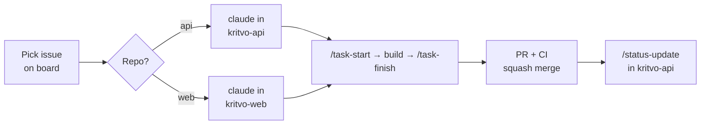

# Setup guide

Follow these steps once, in order. Each step says how to check it worked. Commands assume macOS, Linux, or Git Bash/WSL on Windows.

Kritvo uses two repositories, cloned side by side:

```text
~/code/kritvo/
├── kritvo-api/   backend, infra, ALL docs, OpenAPI contract, GitHub bootstrap script
└── kritvo-web/   office app, technician PWA, client portal
```

## Part A — Your computer

### 1. Install the tools

| Tool | Why | Check |
| --- | --- | --- |
| Git | Version control | `git --version` |
| GitHub CLI (`gh`) | Repositories, issues, PRs from the terminal | `gh --version` |
| VS Code | Editor | — |
| Claude Code | AI pair programmer in the terminal and VS Code ([docs](https://docs.claude.com/en/docs/claude-code/overview)) | `claude --version` |
| Node.js 24 (via nvm or fnm) and pnpm | Web app; also runs the Markdown linter | `node -v`, `pnpm -v` |
| uv (installs Python 3.13 itself) | FastAPI backend | `uv --version` |
| Docker Desktop | Local PostgreSQL and the full stack | `docker info` |

### 2. Sign in

```bash
git config --global user.name  "Your Name"
git config --global user.email "you@example.com"
git config --global init.defaultBranch main
gh auth login                  # GitHub.com, SSH, upload your SSH key
gh auth refresh -s project     # lets the script create the project board
```

Check: `gh auth status` shows you logged in with the `project` scope.

## Part B — Create both repositories

### 3. Unpack the starter kits

```bash
mkdir -p ~/code/kritvo && cd ~/code/kritvo
unzip ~/Downloads/kritvo-api-starter.zip
unzip ~/Downloads/kritvo-web-starter.zip
```

Open `kritvo-api/kritvo.code-workspace` in VS Code to see both repositories in one window.

### 4. Replace the placeholders

| File | Replace |
| --- | --- |
| `kritvo-api/.github/CODEOWNERS`, `kritvo-web/.github/CODEOWNERS` | `YOUR_GITHUB_USERNAME` with your GitHub username |
| `LICENSE` in both | Company name, once incorporated |
| `SECURITY.md` in both | Contact address |
| `kritvo-api/docs/architecture/HLD.md`, `LLD.md` | **Owner** row, if you want your name there |

### 5. First commit and push, API first

```bash
cd ~/code/kritvo/kritvo-api
chmod +x scripts/*.sh
git init && git add -A
git commit -m "chore(repo): repository foundations (TASK-000)"
gh repo create kritvo-api --private --source=. --remote=origin --push

cd ~/code/kritvo/kritvo-web
chmod +x scripts/*.sh
git init && git add -A
git commit -m "chore(repo): repository foundations (TASK-000)"
gh repo create kritvo-web --private --source=. --remote=origin --push
```

Check: both repositories open on GitHub, and each **Actions** tab shows workflows running.

### 5b. Check the backend runs

```bash
cd ~/code/kritvo/kritvo-api
uv sync && cp .env.example .env
uv run pytest                                        # all tests pass
uv run uvicorn kritvo.main_api:app --reload          # open http://localhost:8000/docs
docker compose up --build                            # API :8000, gateway :8001, PostgreSQL :5432
```

Check: `curl localhost:8000/healthz` returns `{"status":"ok","version":"0.1.0"}`.

### 6. Run the GitHub bootstrap script (once, from kritvo-api)

```bash
cd ~/code/kritvo/kritvo-api
scripts/bootstrap-github.sh
```

For both repositories it sets squash-only merging, labels and milestones, and protects `main`. It then:

- opens every task from `docs/planning/TASKS.md` as an issue in the repository its **Repo** column names (business tasks go to `kritvo-api`);
- creates one **Kritvo Roadmap** project board holding issues from both repositories;
- tags `hld-v2.0` and `lld-v1.2` in `kritvo-api`.

Check: `kritvo-api` issues include `BIZ-001` and `TASK-001`; `kritvo-web` issues include `TASK-023` and `TASK-016`; `git tag` in `kritvo-api` lists both doc tags.

If branch protection fails: GitHub requires a paid plan (Pro or Team) to protect branches in private repositories. Upgrade, or follow the pull-request-only workflow by discipline.

### 7. Finish the board and secrets

1. Project board: add **In review** and **Blocked** to the Status field, show the **Repository** field, and use the Board layout.
2. Secrets (each repository: **Settings → Secrets and variables → Actions**):
   - `ANTHROPIC_API_KEY` in both, only if you want the `claude-review` workflow.
   - `GITLEAKS_LICENSE` in both, only if the repositories belong to an organization.
3. After TASK-001 and TASK-023, turn on the web contract check:
   - Create a fine-grained personal access token with read-only **Contents** access to `kritvo-api`.
   - Add it to `kritvo-web` as the secret `API_REPO_READ_TOKEN`.
   - Add the repository variable `API_CONTRACT_CHECK` = `true` in `kritvo-web`.
4. Optional: in Claude Code, run `/install-github-app` in each repository so you can mention `@claude` in issues and PRs.

Check: the latest runs on `main` are green (`ci`, `docs`, `secret-scan` in kritvo-api; `ci`, `secret-scan` in kritvo-web).

## Part C — Connect Claude

### 8. Claude Code

```bash
cd ~/code/kritvo/kritvo-api && claude     # backend and docs work
cd ~/code/kritvo/kritvo-web && claude     # UI work
```

In each session:

- Run `/context` and confirm `CLAUDE.md` loaded (in kritvo-api, `docs/status/STATUS.md` too).
- Type `/` and check the skills. kritvo-api: `task-start`, `task-finish`, `new-module`, `doc-change`, `adr-new`, `status-update`, `doc-version`. kritvo-web: `task-start`, `task-finish`.
- In kritvo-web, run `/permissions` and confirm `../kritvo-api/docs` and `../kritvo-api/openapi` are listed as additional directories, and the rules blocking edits to `../kritvo-api` appear.
- In kritvo-web, run `scripts/check-api-sibling.sh`.

### 9. Claude.ai project (design and review work)

1. Remove the old uploaded `01_HLD_Solution_Document.md`; it is archived in `kritvo-api` and would confuse answers.
2. Add both repositories through the GitHub integration and select the files listed in `kritvo-api/docs/README.md`.
3. Paste the block from `docs/product/PROJECT_CONTEXT.md` into section 2 of the project instructions, and update section 5's file table to the new paths.
4. After every merge that changes docs, press **Sync now**.

### 10. Claude Docs (live drafts)

The HLD and LLD also exist as Claude Docs from the design conversation. Treat them as drafting copies; bring final text into `kritvo-api` with `/doc-change`. If they differ, the repository wins.

## Part D — Daily workflow



1. Move an issue to **In progress**. Its **Repository** field tells you where to work.
2. Open Claude Code in that repository and run `/task-start TASK-###`. Approve the plan before it writes code.
3. Build and test. Use Claude.ai for design questions; paste its handoff prompts into Claude Code.
4. `/task-finish` runs checks, updates `CHANGELOG.md`, commits, and opens the PR.
5. Merge when checks are green (add the `claude-review` label first if you want an AI review).
6. At the end of the day, in a `kritvo-api` session: `/status-update`. It reads both repositories and updates the worklog, `STATUS.md` and the Status column in `TASKS.md`.

### A task that needs both repositories

1. In `kritvo-api`: add or extend the endpoint backward-compatibly, regenerate `openapi/openapi.json`, merge.
2. In `kritvo-web`: `git -C ../kritvo-api pull`, `pnpm gen:api`, build the UI, open the PR with the same task ID and `Closes <owner>/kritvo-api#<issue>` if the issue lives there.
3. Remove old API fields only later, once the web app no longer uses them.

### Changing a design document (always in kritvo-api)

1. `/doc-change LLD <what to change>` (or HLD).
2. Merge; CI blocks the PR if the Version row was not bumped.
3. Tag it: `git switch main && git pull && git tag -a lld-v1.3 -m "<summary>" && git push origin lld-v1.3`.
4. Press **Sync now** in the Claude.ai project.

### Looking back or rolling back (in kritvo-api)

```bash
scripts/doc-version.sh list    docs/architecture/HLD.md
scripts/doc-version.sh diff    docs/architecture/HLD.md hld-v2.0
scripts/doc-version.sh export  docs/architecture/HLD.md hld-v2.0   # then upload tmp/… to Claude
scripts/doc-version.sh restore docs/architecture/HLD.md hld-v2.0   # new branch, new version number
```

More detail: [Git workflow](../engineering/GIT_WORKFLOW.md#document-versions-and-rollback).

### Weekly and monthly routine

- **Weekly:** review the board and blocked items; refresh `STATUS.md`; accept or reject pending ADRs; check both repositories' Dependabot PRs.
- **Monthly:** start a new `docs/status/worklog/YYYY-MM.md`; tag releases in each repository that shipped something (`v0.x.y`).

## Part E — First tasks after setup

1. **Practice run (TASK-000):** in `kritvo-api`, `/task-start TASK-000`, set TASK-000 to Done in `TASKS.md`, update `STATUS.md`, `/task-finish`. This tests branches, the PR title check, CI and merging end to end.
2. **BIZ-001:** run the name checks from HLD section 1.4.
3. **TASK-001** in `kritvo-api`: the FastAPI scaffold is already in the starter. Confirm CI is green (tests, type checks, Docker build, contract check) and `docker compose up` works, then mark it Done through a PR.
4. **TASK-023** in `kritvo-web`: scaffold the app, fill in the Commands section of its `CLAUDE.md`, and enable its Dependabot entry.
5. **TASK-002:** database foundation; use `/new-module` for later feature modules.

## Troubleshooting

| Problem | Fix |
| --- | --- |
| `docs-lint` fails with "changed without a Version bump" | Update the Version row and add a Revision history row, or use `/doc-change` |
| `pr-title` fails | Rename the PR: `type(scope): summary (TASK-###)` |
| Claude in kritvo-web cannot read the docs | Clone `kritvo-api` next to it and start `claude` from the kritvo-web root |
| `api-contract` fails in kritvo-web | Pull kritvo-api, run `pnpm gen:api`, commit; or update the UI for the new contract |
| Skills do not appear in Claude Code | Start `claude` from the repository root; check `.claude/skills/<name>/SKILL.md` exists |
| Claude.ai answers from the old design | Remove old uploads; press **Sync now** |
| `bootstrap-github.sh` says it cannot see kritvo-web | Push kritvo-web first, or run `WEB_REPO=<owner>/<name> scripts/bootstrap-github.sh` |
